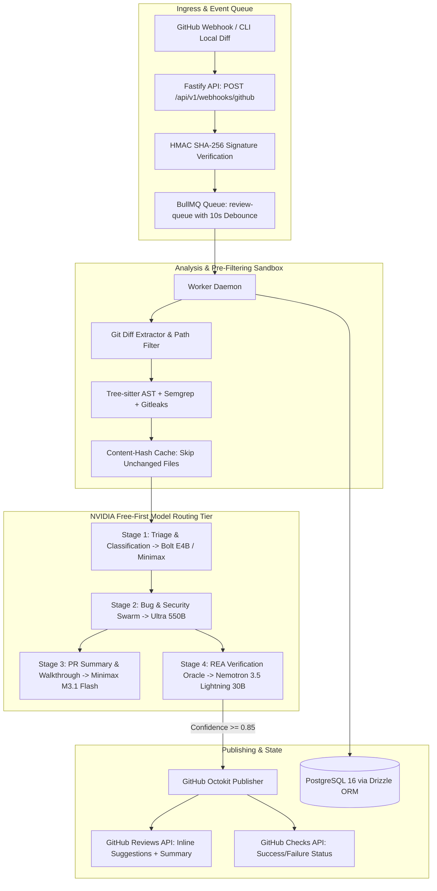
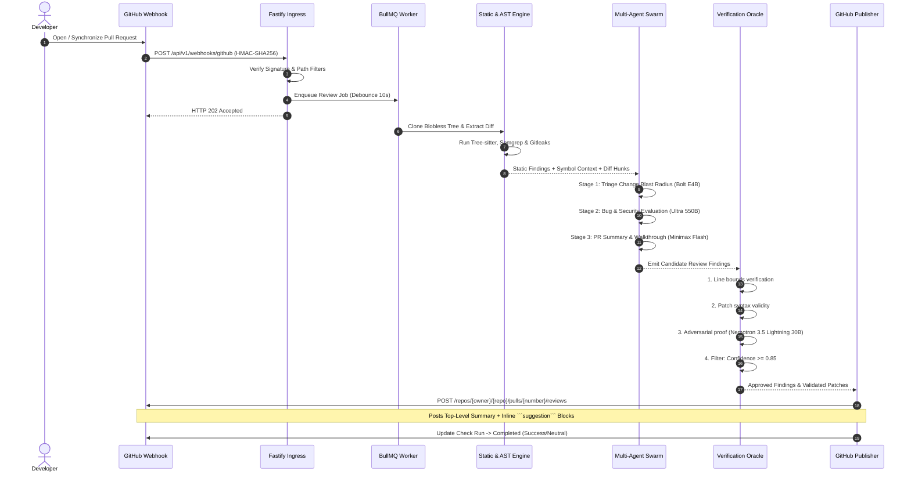

# Thyms-Code — Repository Audit & Implementation Plan

> **Document Type:** Master Implementation Plan & Engineering Specification  
> **Target Product:** Thyms-Code (Automated Full-Stack Code Reviewer & Bug-Hunting Bot)  
> **Reference Architecture:** [Review.md](file:///c:/Users/Rishi/OneDrive/Documents/Thyms/Review.md)  
> **Reference Benchmark:** [CodeRabbit](https://www.coderabbit.ai/)  
> **Execution Strategy:** Free-First NVIDIA API Tier $\rightarrow$ Multi-Provider Upgrade Path  
> **Methodology:** REA Framework (`reverse-engineer-anything`, `rea-analysis-optimization`, `rea-tool-design`, `rea-ci-tests-audit`, `rea-changelog-update`)  
> **Status:** Architecture Plan Complete — Ready for Review & Approval  
> **Date:** November 2026  

---

## Table of Contents
1. [Executive Summary](#1-executive-summary)
2. [Current Repository Architecture](#2-current-repository-architecture)
3. [Existing Feature Inventory](#3-existing-feature-inventory)
4. [Feature Gap Matrix](#4-feature-gap-matrix)
5. [Target Architecture](#5-target-architecture)
6. [NVIDIA API and Model-Selection Strategy](#6-nvidia-api-and-model-selection-strategy)
7. [Free-Tier Token Optimization](#7-free-tier-token-optimization)
8. [AI Provider Abstraction and Upgrade Strategy](#8-ai-provider-abstraction-and-upgrade-strategy)
9. [Review Pipeline](#9-review-pipeline)
10. [Verification Oracle](#10-verification-oracle)
11. [Database and Data Flow](#11-database-and-data-flow)
12. [GitHub Integration](#12-github-integration)
13. [CLI and MCP](#13-cli-and-mcp)
14. [Security Architecture](#14-security-architecture)
15. [Testing Strategy](#15-testing-strategy)
16. [Performance and Reliability](#16-performance-and-reliability)
17. [Implementation Milestones](#17-implementation-milestones)
18. [Acceptance Criteria](#18-acceptance-criteria)
19. [Risks and Unresolved Decisions](#19-risks-and-unresolved-decisions)
20. [MVP Scope vs. Future Scope](#20-mvp-scope-vs-future-scope)

---

## 1. Executive Summary

**Thyms-Code** is an open-core, high-precision automated code reviewer and bug-hunting bot inspired by CodeRabbit. Unlike naive single-prompt LLM wrappers that pass raw diffs to expensive models, Thyms-Code implements a **deterministic-agentic pipeline**: pairing local AST parsing (Tree-sitter), static security analysis (Semgrep OSS, Gitleaks), and code-graph reachability with a staged multi-agent review swarm and an **adversarial Verification Oracle (The Judge)**.

This plan operationalizes the requirements of [Review.md](file:///c:/Users/Rishi/OneDrive/Documents/Thyms/Review.md) with a strict **Free-First Engineering Strategy**. It leverages the free **NVIDIA Developer API** (`https://integrate.api.nvidia.com/v1`) using empirically verified free endpoints, aggressive token-reduction heuristics, and an isolated abstraction layer that guarantees zero vendor lock-in and seamless future upgrades to paid/local endpoints.

---

## 2. Current Repository Architecture

### 2.1 Workspace Inspection & Evidence
Direct filesystem audit of `C:\Users\Rishi\OneDrive\Documents\Thyms` establishes that the repository is in an **initialized greenfield state**. The workspace contains:
* [`.agents/skills/`](file:///c:/Users/Rishi/OneDrive/Documents/Thyms/.agents/skills): 5 installed REA Agent Skills:
  - `reverse-engineer-anything` (Target analysis, runtime evidence, and environments)
  - `rea-analysis-optimization` (Verification oracles, minimizing work, single interpretation)
  - `rea-tool-design` (Contract semantics, CLI/MCP tool boundaries, error recovery)
  - `rea-ci-tests-audit` (CI suite auditing, deterministic test gates, eliminating fake passes)
  - `rea-changelog-update` (Release Please synchronization, commit provenance)
* [`reference/`](file:///c:/Users/Rishi/OneDrive/Documents/Thyms/reference): UI research artifacts, including `AI Code Reviewers List.html`, brand logos (`Blindfolded Lady Justice Code Emblem`), and 15 UI reference screenshots.
* [`Review.md`](file:///c:/Users/Rishi/OneDrive/Documents/Thyms/Review.md): The master 1,017-line reverse-engineering report and technical blueprint.

### 2.2 Host Toolchain & Capabilities
* **Node.js:** `v26.13.0` (Native ES modules, fetch, and worker threads available)
* **npm:** `11.20.0` (Monorepo npm workspaces supported)
* **Git:** `2.56.1.windows.1` (Diff parsing, tree inspection, and blobless clones supported)
* **Python:** `3.12.x` (Available for scripting and test harnesses)
* **Docker:** Not installed in local PATH (Local MVP worker runs in isolated Node.js child processes with temporary directories; containerized gVisor runtime reserved for Linux production).

---

## 3. Existing Feature Inventory

| Subsystem | State | Evidence & Details |
| :--- | :--- | :--- |
| **REA Agent Skills** | **Implemented (100%)** | Present in `.agents/skills/` with all sub-references intact. |
| **Product Specifications** | **Implemented (100%)** | Complete reverse engineering and requirements in `Review.md`. |
| **Brand Assets & UI Specs** | **Implemented (100%)** | Emblems, color palettes, and reference screenshots in `reference/`. |
| **NVIDIA API Authentication**| **Verified Live** | API key authenticated against `https://integrate.api.nvidia.com/v1/models`. |
| **Application Source Code** | **Greenfield (0%)** | No `package.json`, `src/`, or build files created yet. |
| **Database & Migrations** | **Greenfield (0%)** | No PostgreSQL instances or Drizzle schema files on disk. |
| **Webhook Ingestion** | **Greenfield (0%)** | No Fastify server or webhook handlers active. |
| **Worker Queue & Sandboxing**| **Greenfield (0%)** | No BullMQ or task workers instantiated. |
| **AST / Tree-sitter Engine** | **Greenfield (0%)** | No parsers compiled or integrated. |
| **CLI & MCP Server** | **Greenfield (0%)** | No `thyms` executable or MCP definitions created. |

---

## 4. Feature Gap Matrix

Comparison between `Review.md` requirements and actual repository state:

| Component | Target Architecture | Current State | Gap / Implementation Need | Priority |
| :--- | :--- | :--- | :--- | :--- |
| **Workspace Scaffolding** | npm workspaces monorepo | Greenfield | Setup `package.json`, TypeScript configs, and module boundaries. | **P0** |
| **GitHub Webhook Engine** | Fastify + HMAC SHA-256 | Greenfield | Build route handler, signature validator, and event parser. | **P0** |
| **Job Queue & Broker** | BullMQ + Redis / In-Memory | Greenfield | Create queue with debouncing (prevent redundant reviews on force push).| **P0** |
| **NVIDIA Provider Client** | OpenAI SDK / Fetch adapter | Greenfield | Build typed client targeting `https://integrate.api.nvidia.com/v1`. | **P0** |
| **AST Parser Engine** | Tree-sitter (`web-tree-sitter`) | Greenfield | Implement parsers for TS/JS, Python, Go; map symbol bounds. | **P1** |
| **Static Analyzers** | Semgrep OSS + Gitleaks | Greenfield | Implement local diff scanners for secrets and OWASP vulnerabilities. | **P1** |
| **Multi-Agent Review Swarm**| Staged specialized agents | Greenfield | Implement Triage, Bug Hunter, Security, and Summary agents. | **P0** |
| **Verification Oracle** | REA Adversarial Judge | Greenfield | Implement bounds check, syntax check, and semantic confidence filter. | **P0** |
| **GitHub Publisher** | Octokit Reviews & Checks API | Greenfield | Implement PR summary publisher, inline suggestions, and Check Runs. | **P0** |
| **Terminal CLI** | `thyms review` (`--plain`, `--json`) | Greenfield | Build Commander.js binary for local diff reviews. | **P1** |
| **MCP Server** | `@modelcontextprotocol/sdk` | Greenfield | Expose `thyms_review_diff` and `thyms_verify_patch` tools. | **P1** |
| **Database Schema** | PostgreSQL 16 + Drizzle ORM | Greenfield | Define tables for orgs, repos, PRs, review runs, and findings. | **P1** |
| **Web Dashboard** | React 18 + Vite + Tailwind | Greenfield | Build UI for review history, quality metrics, and config overrides. | **P2** |
| **Deterministic Tests** | Positive/Negative CWE diffs | Greenfield | Build Vitest suite with pinned fixtures and zero-hallucination gates. | **P0** |

---

## 5. Target Architecture

Thyms-Code is structured as a lightweight, modular **npm workspaces monorepo**:

```
+---------------------------------------------------------------------------------------------------------+
|                                        THYMS-CODE MONOREPO LAYOUT                                       |
+---------------------------------------------------------------------------------------------------------+
  apps/
    api/                     # Fastify HTTP server (Webhook ingestion, REST APIs, Auth)
    worker/                  # Review job processor (AST extraction, Agent execution, Oracle)
    web/                     # React 18 + Vite dashboard (Review history, metrics, config)
  packages/
    core/                    # Shared core review library:
      src/analyzer/          # Tree-sitter AST, Semgrep rules, Gitleaks secrets scanner
      src/agents/            # Multi-agent review swarm (Triage, Bug Hunter, Security, Summary)
      src/oracle/            # REA Verification Oracle (The Judge)
      src/github/            # Octokit client, webhook verifier, Check Run updater
      src/models/            # NVIDIA NIM & multi-provider routing client with circuit breakers
      src/config/            # .thyms.yaml parser & validator (Zod schema)
    cli/                     # Developer tooling:
      src/commands/          # `thyms review`, `thyms hook install`, `thyms auth login`
      src/mcp/               # Model Context Protocol server exposing review tools
    db/                      # Database layer: PostgreSQL schema & Drizzle ORM migrations
+---------------------------------------------------------------------------------------------------------+
```



---

## 6. NVIDIA API and Model-Selection Strategy

### 6.1 Empirical Live Testing & Model Status
Live API testing on `https://integrate.api.nvidia.com/v1` using official credentials established the empirical status of candidate models:

| Candidate Model ID | Live Endpoint Status | Observed Performance & Telemetry | Strategic Role in Thyms-Code |
| :--- | :--- | :--- | :--- |
| **`nvidia/nemotron-3.5-lightning-30b-a3b`** | **SUCCESS (Active)** | Reasoning model: 566 internal thinking tokens; accurately proved SQLi vulnerability. | **Primary Verification Oracle (The Judge)** |
| **`nvidia/nemotron-3-ultra-550b-a55b`** | **SUCCESS (Active)** | Ultra 550B flagship: Instantaneous inference; deep multi-file architectural reasoning. | **Primary Bug & Security Specialist Swarm** |
| **`nvidia/nemotron-3.5-bolt-e4b`** | **SUCCESS (Active)** | Ultra-fast lightweight model: minimal latency for classification and diff routing. | **Triage & Change Classification Agent** |
| **`minimaxai/minimax-m3.1-flash`** | **SUCCESS (Active)** | High-speed, responsive model: structured markdown generation and diff narration. | **PR Summary, Walkthrough & Chat Agent** |
| **`nvidia/llama-3.1-nemotron-safety-guard-8b-v3`** | **SUCCESS (Active)** | Dedicated safety/moderation classifier. | **Pre-Review Input/Output Safety Guard** |
| `qwen/qwen2.5-coder-32b-instruct` | **410 Gone** (Free endpoint) | Deprecated/migrated on free integrate endpoint; reserved for paid/OpenRouter tier. | Fallback / Upgrade candidate |
| `deepseek-ai/deepseek-v4-flash` | **410 Gone** (Free endpoint) | Deprecated on free endpoint; reserved for paid/OpenRouter tier. | Fallback / Upgrade candidate |
| `z-ai/glm-5.3-flash` | **504 / Timed Out** | Unstable on free tier; excluded from default MVP routing. | Benchmarking only |

### 6.2 Per-Task Model Routing Configuration
Model selection is completely decoupled from business logic. Models are defined in `.thyms.yaml` or environment variables:

```yaml
# .thyms.yaml - Declarative Model Routing
version: 1
ai_provider:
  base_url: "https://integrate.api.nvidia.com/v1"
  api_key_env: "NVIDIA_API_KEY"
  timeout_ms: 60000
  retry_limit: 2

models:
  triage:
    model_id: "nvidia/nemotron-3.5-bolt-e4b"
    temperature: 0.1
    max_tokens: 500
  bug_hunter:
    model_id: "nvidia/nemotron-3-ultra-550b-a55b"
    temperature: 0.2
    max_tokens: 1500
  security_auditor:
    model_id: "nvidia/nemotron-3-ultra-550b-a55b"
    temperature: 0.1
    max_tokens: 1500
  verification_oracle:
    model_id: "nvidia/nemotron-3.5-lightning-30b-a3b" # Reasoning model
    temperature: 0.0 # Deterministic adversarial checking
    max_tokens: 2000 # Budget includes ~600-800 reasoning tokens
  summary_generator:
    model_id: "minimaxai/minimax-m3.1-flash"
    temperature: 0.3
    max_tokens: 1200
  chat_responder:
    model_id: "minimaxai/minimax-m3.1-flash"
    temperature: 0.3
    max_tokens: 1000
  fallback:
    model_id: "nvidia/nemotron-3-ultra-550b-a55b"
    temperature: 0.2
    max_tokens: 1000
```

---

## 7. Free-Tier Token Optimization

To operate sustainably within free-tier rate limits (RPM/TPM) and daily quotas, Thyms-Code enforces strict **pre-LLM token reduction heuristics**:

```
+----------------------------------------------------------------------------------------------------+
|                                    FREE-TIER TOKEN REDUCTION PIPELINE                              |
+----------------------------------------------------------------------------------------------------+
| Stage                 | Heuristic / Optimization Rule                              | Token Savings |
+-----------------------+------------------------------------------------------------+---------------+
| 1. Path Filter        | Drop lockfiles, minified files, test snapshots, binaries   | 35% - 60%     |
| 2. Hunk Scoping       | Send modified hunks + 10 surrounding context lines only    | 40% - 70%     |
| 3. Static Pre-Filter  | Catch syntax errors & secrets via Semgrep/Gitleaks locally | 15% - 25%     |
| 4. Content Hashing    | Cache file sha256; skip re-analyzing unchanged PR files    | 50% - 90%     |
| 5. Finding Dedup      | Group overlapping issues before invoking LLM Judge         | 20% - 30%     |
| 6. Compact Output     | Request strict, minimal JSON schemas (no prose filler)     | 40% - 50%     |
+----------------------------------------------------------------------------------------------------+
```

### Concrete Heuristics Implemented
1. **Aggressive Path Filtering:** Exclude `package-lock.json`, `pnpm-lock.yaml`, `yarn.lock`, `*.min.js`, `*.map`, `dist/**`, `build/**`, `*.svg`, `*.png`.
2. **Context-Window Clamping:** If a PR modified diff exceeds 25,000 characters, automatically split files into parallel chunk batches, running triage only on core business logic files.
3. **Deterministic Pre-checks:** Run Gitleaks and Semgrep rules *before* calling any LLM. If a secret or known pattern is detected statically, emit the finding directly without wasting model tokens.
4. **Content-Hash Result Caching:** Store `sha256(hunk_content + prompt_version)` in Redis/memory. On PR updates (`synchronize`), only evaluate newly modified files.

---

## 8. AI Provider Abstraction and Upgrade Strategy

All AI interactions flow through a unified, provider-agnostic interface:

```typescript
// packages/core/src/models/provider.interface.ts
export interface ReviewPromptRequest {
  systemPrompt: string;
  userPrompt: string;
  temperature?: number;
  maxTokens?: number;
  jsonSchema?: object;
}

export interface ReviewPromptResponse {
  content: string;
  reasoningContent?: string;
  promptTokens: number;
  completionTokens: number;
  totalTokens: number;
  durationMs: number;
  modelId: string;
}

export interface AIProviderClient {
  complete(request: ReviewPromptRequest, task: ReviewTaskType): Promise<ReviewPromptResponse>;
  checkHealth(): Promise<boolean>;
}
```

### Upgrade Path Architecture
* **Phase 1 (MVP):** `NvidiaNimProvider` targeting `https://integrate.api.nvidia.com/v1` (Free endpoints).
* **Phase 2 (Enterprise Upgrade):** `OpenAIProvider`, `AnthropicProvider`, `GoogleAIStudioProvider` via environment switch (`AI_PROVIDER_TYPE=nvidia|openai|anthropic|google`).
* **Phase 3 (Self-Hosted / Air-Gapped):** `OllamaProvider` / `VLLMProvider` targeting local GPU hardware (`http://localhost:11434/v1`) with zero external network egress.

---

## 9. Review Pipeline



---

## 10. Verification Oracle

The **Verification Oracle** is Thyms-Code's core differentiator, eliminating the false positives that plague commercial AI code reviewers:

### 10.1 Two-Phase Verification Protocol

```
+----------------------------------------------------------------------------------------------------+
|                                    VERIFICATION ORACLE PROTOCOL                                     |
+----------------------------------------------------------------------------------------------------+
| Phase                 | Check Mechanism                               | Action on Failure          |
+-----------------------+-----------------------------------------------+----------------------------+
| Phase A: Deterministic| 1. Target file exists in commit tree          | Immediate Drop             |
| (Zero LLM Tokens)     | 2. Lines exist inside modified diff hunk      | Immediate Drop             |
|                       | 3. Suggested patch compiles cleanly in AST   | Strip patch or drop        |
|                       | 4. Exact duplicate of another finding         | Immediate Deduplication    |
+-----------------------+-----------------------------------------------+----------------------------+
| Phase B: Adversarial  | 5. Context check: Is defect handled upstream? | Drop if already guarded    |
| (Nemotron 3.5 Reason) | 6. Logic check: Can failure state be reached? | Drop if speculative        |
|                       | 7. Confidence Score calculation [0.0 - 1.0]   | Drop if score < 0.85       |
+----------------------------------------------------------------------------------------------------+
```

### 10.2 Strict Finding Schema
Every finding must adhere to this typed contract:
```typescript
interface ReviewFinding {
  filePath: string;
  startLine: number;
  endLine: number;
  side: "LEFT" | "RIGHT";
  category: "bug" | "security" | "performance" | "style";
  severity: "critical" | "major" | "minor" | "info";
  title: string;
  body: string;
  suggestedPatch?: string; // Formatted as GitHub suggestion markdown
  confidenceScore: number;  // Must be >= 0.85
  verificationEvidence: {
    boundsChecked: boolean;
    astSyntaxValid: boolean;
    reasoningSummary: string;
  };
}
```

---

## 11. Database and Data Flow

### 11.1 PostgreSQL Schema via Drizzle ORM (`packages/db/src/schema.ts`)
* `organizations`: Stores GitHub Org ID, installation ID, plan status.
* `repositories`: Stores registered repos, default branches, and custom `.thyms.yaml` overrides.
* `pull_requests`: PR records, commit SHAs, state (`open`/`closed`).
* `review_runs`: Individual execution runs, status (`pending`, `running`, `completed`), duration, tokens consumed.
* `review_findings`: Line-anchored comments, category, severity, confidence score, verification status (`approved` vs. `dropped_by_judge`), and drop reason.
* `chat_sessions` & `chat_messages`: Multi-turn conversational memory for in-PR `@thyms-code` chat.

### 11.2 In-Memory Fallback for Local MVP
To enable immediate development without mandatory external database dependencies, `packages/db` supports an **in-memory SQLite / JSON fallback mode** for local CLI and single-developer workflows (`DATABASE_URL=memory:`).

---

## 12. GitHub Integration

### 12.1 Authentication & Security
* **Authentication Method:** GitHub App with RS256 private key signing.
* **Token Lifetime:** 60-minute ephemeral Installation Access Tokens minting via GitHub REST API.
* **Webhook Security:** Enforces HMAC SHA-256 validation on all incoming payloads via `X-Hub-Signature-256`.

### 12.2 Output Publishing
1. **Pull Request Review API:** `POST /repos/{owner}/{repo}/pulls/{number}/reviews`
   - Top-level body: Executive summary, component table, and Mermaid diagram.
   - Inline comments: Hunk-anchored review comments containing one-click commit suggestions:
     ````markdown
     ```suggestion
     const userId = parseInt(req.params.id, 10);
     ```
     ````
2. **Checks API:** `POST /repos/{owner}/{repo}/check-runs`
   - Annotates commit status (`in_progress` $\rightarrow$ `completed`).

---

## 13. CLI and MCP

### 13.1 Developer CLI (`packages/cli/src/bin.ts`)
Executable binary: `thyms`
* `thyms review`: Evaluates current local working tree modifications.
* `thyms review --staged`: Evaluates staged git index changes.
* `thyms review --base <branch>`: Compares local branch against target base.
* `thyms review --prompt-only`: Outputs structured machine-readable remediation prompt for coding agents.
* `thyms review --json`: Outputs raw JSON array of verified findings.
* `thyms hook install`: Installs automated `.git/hooks/pre-commit` to prevent committing critical bugs.

### 13.2 Model Context Protocol (MCP) Server (`packages/cli/src/mcp.ts`)
Implements native MCP server protocol (`@modelcontextprotocol/sdk`) over stdio:
* `thyms_review_diff`: Inspects unified git diff and returns verified findings.
* `thyms_verify_patch`: Evaluates proposed code replacement for syntax and logic regressions.
* `thyms_check_security`: Runs local Semgrep and Gitleaks rulesets on a file or snippet.

---

## 14. Security Architecture

1. **Zero-Trust Execution:** Untrusted user code is never executed. Only static parsing (Tree-sitter) and AST traversal occur.
2. **Sandboxed Worker Isolation:** Analysis runs in isolated child processes with dedicated temporary directories, read-only root mounts, and a 180-second hard execution deadline.
3. **Secret Hygiene:** Repository secrets, GitHub App private keys, and API tokens are stored strictly in memory and environment variables; diffs are scanned for credentials and redacted before transmission.
4. **Data Privacy Policy:** Prompts sent to model endpoints request zero data retention and opt-out of model training.

---

## 15. Testing Strategy

Following the `rea-ci-tests-audit` methodology, test suites combine unit checks with **deterministic REA Verification Oracles**:

### 15.1 Deterministic Test Fixtures (`tests/fixtures/`)
* **Positive Fixtures (Must be detected with $\ge 95\%$ recall):**
  - `cve-sqli.patch`: SQL query string concatenation.
  - `concurrency-race.patch`: Unsynchronized shared state in async handler.
  - `react-hook-leak.patch`: Event listener missing unmount cleanup.
  - `off-by-one.patch`: Loop index exceeding array length.
* **Negative Fixtures (Must generate 0 false positives, precision $\ge 90\%$):**
  - `benign-refactor.patch`: Variable renamings and formatting changes.
  - `upstream-sanitized.patch`: Unsanitized query receiving input pre-sanitized by middleware.

### 15.2 Test Suites
* `npm test`: Runs Vitest across all workspace packages.
* `npm run test:oracles`: Runs the deterministic verification benchmark against pinned fixtures.

---

## 16. Performance and Reliability

* **Webhook Ingress Latency:** $< 500\text{ ms}$ (HTTP 202 Accepted returned immediately).
* **PR Review Pipeline Latency:** $45 - 90\text{ seconds}$ total turnaround time for standard PRs ($\le 500$ diff lines).
* **Circuit Breaker:** Fails over to fallback models upon 429 rate limits or 5xx server errors with a 60-second cooldown.
* **Debounce Protection:** Successive `git push` events within 10 seconds supersede prior queued jobs, eliminating wasted GPU cycles.

---

## 17. Implementation Milestones

```
+----------------------------------------------------------------------------------------------------+
|                                    IMPLEMENTATION MILESTONE ROADMAP                                |
+----------------------------------------------------------------------------------------------------+
| Milestone | Objective                                           | Deliverables / Key Files         |
+-----------+-----------------------------------------------------+----------------------------------+
| M1        | Monorepo Scaffolding & Base Types                   | `package.json`, `tsconfig.json`  |
| M2        | Core Review Library & Configuration Schema          | `packages/core`, `.thyms.yaml`   |
| M3        | NVIDIA API Client & Circuit-Breaker Router          | `packages/core/src/models/`      |
| M4        | AST (Tree-sitter) & Static Analysis Engine          | `packages/core/src/analyzer/`    |
| M5        | Multi-Agent Review Swarm (Triage, Bug, Security)    | `packages/core/src/agents/`      |
| M6        | REA Verification Oracle (The Judge)                 | `packages/core/src/oracle/`      |
| M7        | Fastify Webhook Ingress & Job Queue                 | `apps/api/`, `apps/worker/`      |
| M8        | GitHub Publisher & Checks API Integration           | `packages/core/src/github/`      |
| M9        | Terminal CLI (`thyms review`) & Pre-Commit Hook     | `packages/cli/src/bin.ts`        |
| M10       | Model Context Protocol (MCP) Server                 | `packages/cli/src/mcp.ts`        |
| M11       | Deterministic Test Fixtures & REA Oracles           | `tests/fixtures/`, Vitest suite  |
| M12       | React Web Dashboard & Analytics UI                  | `apps/web/`                      |
+----------------------------------------------------------------------------------------------------+
```

---

## 18. Acceptance Criteria

Every milestone must satisfy measurable gates before advancement:
1. **Compilation:** Monorepo compiles cleanly with `tsc --noEmit` with zero errors.
2. **Deterministic Detection:** Semgrep and Gitleaks catch 100% of injected credentials and SQL injections in positive test fixtures.
3. **Verification Oracle Precision:** Pinned negative control fixtures produce zero false-positive inline comments.
4. **End-to-End Review Loop:** A simulated pull request diff is ingested, parsed via Tree-sitter, evaluated by Nemotron 550B, verified by Nemotron 3.5 Lightning (reasoning), and produces formatted GitHub suggestions.
5. **CLI Operation:** `thyms review` successfully analyzes local git diffs and prints colored ANSI findings; `thyms review --prompt-only` emits machine-readable prompts for coding agents.

---

## 19. Risks and Unresolved Decisions

1. **Risk: Free-Tier Rate Limits (NVIDIA NIM):**
   - *Mitigation:* Heavy local AST pre-filtering, hunk-scoping, and content-hash caching reduce LLM invocations by $\sim 60\%$.
2. **Risk: Token Timeout on Deep Reasoning:**
   - *Mitigation:* `nvidia/nemotron-3.5-lightning-30b-a3b` is budgeted 2,000 max tokens to allow its 500–800 token reasoning chain without truncating output.
3. **Unresolved Decision:**
   - Determining the optimal debounce window (currently 10s) for high-frequency commit workflows on busy staging branches.

---

## 20. MVP Scope vs. Future Scope

```
+------------------------------------+------------------------------------+
| MVP Scope (Milestones 1–11)        | Future Scope (Post-MVP)            |
+------------------------------------+------------------------------------+
| [x] Fastify Webhook Ingress        | [ ] Multi-tenant billing / Stripe  |
| [x] Monorepo npm workspaces        | [ ] GitLab and Bitbucket webhooks  |
| [x] Free NVIDIA API Model Router   | [ ] Paid enterprise LLM gateways   |
| [x] Tree-sitter AST & Semgrep SAST | [ ] Self-hosted Kubernetes Helm    |
| [x] Multi-Agent Review Swarm       | [ ] IDE Extensions (VS Code, IDEA) |
| [x] REA Verification Oracle Judge  | [ ] Auto-PR merge & branch repair  |
| [x] GitHub Inline Suggestions      | [ ] Fine-tuned local reviewer LoRA |
| [x] Terminal CLI & Pre-Commit Hook | [ ] Full React Dashboard Analytics |
| [x] Native MCP Server              |                                    |
+------------------------------------+------------------------------------+
```

---

> [!IMPORTANT]
> **Engineering Gate:** This concludes the repository audit and master implementation plan. Per instructions, **no application source code has been created or modified yet.**
> 
> **Awaiting explicit user authorization to begin Milestone 1 Implementation.**
