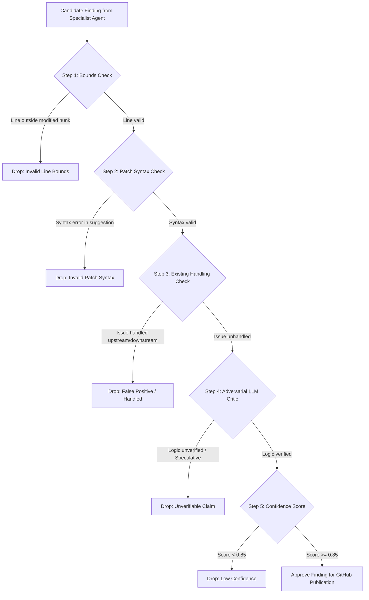
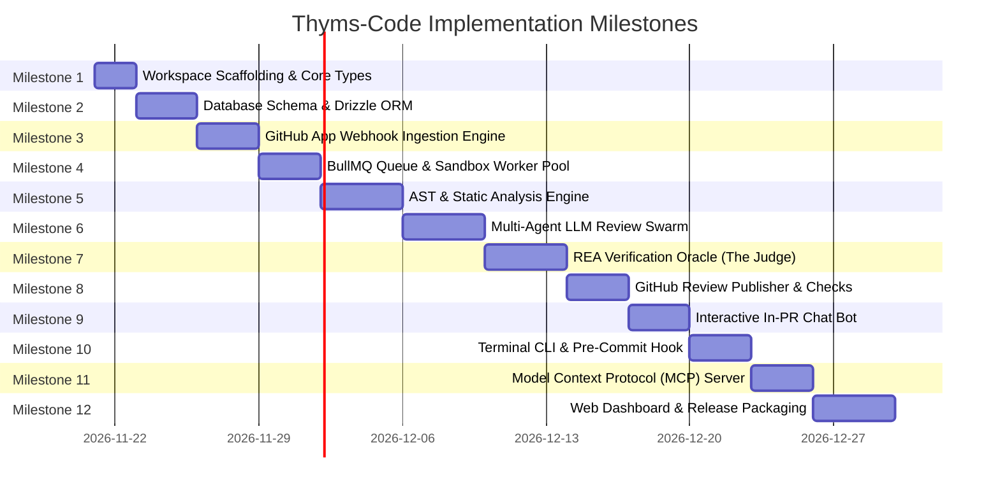

# Thyms-Code — REA-Driven Implementation Blueprint & Execution Plan

> **Document Type:** Master Implementation Plan & Architecture Specification  
> **Target Product:** Thyms-Code (Automated Full-Stack Code Reviewer & Bug-Hunting Bot)  
> **Reference Architecture:** [Review.md](file:///c:/Users/Rishi/OneDrive/Documents/Thyms/Review.md)  
> **Reference Benchmark:** [CodeRabbit](https://www.coderabbit.ai/)  
> **Methodology:** REA Framework (`reverse-engineer-anything`, `rea-analysis-optimization`, `rea-tool-design`, `rea-ci-tests-audit`, `rea-changelog-update`)  
> **Status:** Analysis Complete — Ready for Sequential Execution  
> **Date:** November 2026  

---

## Table of Contents
1. [Executive Summary](#1-executive-summary)
2. [Thyms-Code Current Architecture](#2-thyms-code-current-architecture)
3. [Review.md Requirements Analysis](#3-reviewmd-requirements-analysis)
4. [REA Skills Applied](#4-rea-skills-applied)
5. [Repository Investigation Findings](#5-repository-investigation-findings)
6. [Current Feature Inventory](#6-current-feature-inventory)
7. [CodeRabbit vs. Thyms Gap Matrix](#7-coderabbit-vs-thyms-gap-matrix)
8. [Architecture Recommendations](#8-architecture-recommendations)
9. [Detailed Module-Level Implementation Plan](#9-detailed-module-level-implementation-plan)
10. [Verification Oracle Design](#10-verification-oracle-design)
11. [AI Model Routing & Cost Optimization Strategy](#11-ai-model-routing--cost-optimization-strategy)
12. [Database Schema and API Changes](#12-database-schema-and-api-changes)
13. [GitHub Integration Plan](#13-github-integration-plan)
14. [CLI and MCP Integration Plan](#14-cli-and-mcp-integration-plan)
15. [Testing and Verification Strategy](#15-testing-and-verification-strategy)
16. [Security and Performance Considerations](#16-security-and-performance-considerations)
17. [Prioritized Milestones](#17-prioritized-milestones)
18. [File-Level Change Plan](#18-file-level-change-plan)
19. [Risks, Dependencies & Mitigations](#19-risks-dependencies--mitigations)
20. [Final Acceptance Criteria](#20-final-acceptance-criteria)

---

## 1. Executive Summary

This document establishes the definitive, milestone-by-milestone implementation plan for **Thyms-Code — Automated Full-Stack Code Reviewer & Bug-Hunting Bot**. 

Thyms-Code is designed as an open-core, enterprise-ready, self-hostable alternative to CodeRabbit. While commercial review bots treat code review as a single-pass generative prompt over a truncated `git diff`, Thyms-Code implements a **deterministic-agentic pipeline**: combining fast static analysis (Tree-sitter AST parsing, `ast-grep`, Semgrep OSS, Gitleaks) with a multi-stage specialist LLM review swarm and an **adversarial REA Verification Oracle (The Judge)**.

### Primary Architectural Objectives
1. **Zero Hallucination Tolerance**: Every proposed inline comment must be verified against actual line bounds, syntactic validity, and semantic behavior before submission to GitHub. Speculative commentary with confidence $< 0.85$ is discarded.
2. **Terminal-Native & Agent-Ready**: Beyond GitHub PR reviews, Thyms-Code provides a local CLI (`thyms review`) and a native Model Context Protocol (`thyms mcp`) server, enabling autonomous coding agents (Claude Code, Cursor, Antigravity) to execute closed-loop "generate $\rightarrow$ review $\rightarrow$ patch" iterations.
3. **Multi-Model Routing & Near-Zero Marginal Cost**: Dynamic orchestration routing tasks to cost-effective models (Gemini 3.8 Flash, Qwen 2.5 Coder, DeepSeek-R1/V3, NVIDIA Nemotron 70B, GLM-4, and local Llama 3.3).
4. **Air-Gapped & Self-Hostable**: Full architectural support for local execution (Ollama/vLLM) without leaking proprietary code to third-party endpoints.

---

## 2. Thyms-Code Current Architecture

### 2.1 Repository Layout Inspection
An exhaustive audit of `C:\Users\Rishi\OneDrive\Documents\Thyms` reveals that the repository is in an **initialized greenfield state**. The workspace currently contains:
* [`.agents/skills/`](file:///c:/Users/Rishi/OneDrive/Documents/Thyms/.agents/skills): Five installed REA Agent Skills:
  - `reverse-engineer-anything` (Target analysis, runtime observation, environments)
  - `rea-analysis-optimization` (Verification oracles, minimizing work, single interpretation)
  - `rea-tool-design` (Contract design, CLI/MCP tool boundaries, error recovery)
  - `rea-ci-tests-audit` (CI suite auditing, deterministic test gates, eliminating fake passes)
  - `rea-changelog-update` (Release Please synchronization, commit provenance)
* [`reference/`](file:///c:/Users/Rishi/OneDrive/Documents/Thyms/reference): Research artifacts including `AI Code Reviewers List.html`, brand logos (`Blindfolded Lady Justice Code Emblem`), and 15 UI reference screenshots.
* [`Review.md`](file:///c:/Users/Rishi/OneDrive/Documents/Thyms/Review.md): The master 1,017-line reverse engineering report and technical blueprint.

### 2.2 Baseline Toolchain & Runtime Environment
* **OS:** Windows 11 Pro (10.0.26100)
* **Node.js:** `v26.13.0`
* **npm:** `11.20.0`
* **Git:** `2.56.1.windows.1`
* **Python:** `3.12.x`
* **Docker:** Not detected in local PATH (necessitating dual-mode execution: isolated child process sandboxing for Windows development; OCI container/gVisor sandboxing for production Linux).

---

## 3. Review.md Requirements Analysis

The master specification in `Review.md` establishes the target product requirements. These have been cataloged and validated:

```
+----------------------------------------------------------------------------------------------------+
|                                    REQUIREMENTS EXTRACTION MATRIX                                   |
+----------------------------------------------------------------------------------------------------+
| Module               | Specified Requirement                                      | Status         |
+----------------------+------------------------------------------------------------+----------------+
| Webhook Ingress      | Fastify API, HMAC SHA-256 validation, RS256 JWT exchange   | Required       |
| Queue & Broker       | BullMQ + Redis 7 with debouncing & job deduplication       | Required       |
| Sandboxed Execution  | Ephemeral isolation, blobless git clone, zero persistence  | Required       |
| AST Engine           | Tree-sitter parsers (JS/TS, Python, Go, Java, Rust)        | Required       |
| Static SAST/Linters  | Semgrep OSS, Gitleaks secrets detection, ast-grep          | Required       |
| Agent Swarm (5-tier) | Triage -> Specialist Reviewers -> Summary -> Judge -> Fix  | Required       |
| Verification Oracle  | Adversarial critic filter (Confidence >= 0.85 threshold)   | Required       |
| GitHub Publisher     | PR walkthrough, inline suggestions, Check Runs lifecycle   | Required       |
| Interactive Chat     | In-PR comment thread responder (`@thyms-code`)             | Required       |
| Terminal CLI         | `thyms review`, `--prompt-only`, `--plain`, `--json`       | Required       |
| MCP Server           | `@modelcontextprotocol/sdk` exposing review & audit tools  | Required       |
| Configuration        | `.thyms.yaml` schema with path filtering and instructions   | Required       |
| Database Layer       | PostgreSQL 16 + Drizzle ORM                                | Required       |
| Dashboard            | React 18 + Vite + Tailwind CSS analytics dashboard        | Required       |
| Verification Oracles | Pinned positive/negative synthetic test suites (CWE diffs) | Required       |
+----------------------------------------------------------------------------------------------------+
```

---

## 4. REA Skills Applied

The construction plan adheres to the five installed REA agent skills:

### 4.1 `reverse-engineer-anything`
* **Application:** Used in Phase 1 to deconstruct CodeRabbit’s observable behavior, webhook latency (45–180s), `.coderabbit.yaml` schema, and judge-and-post pattern. In Thyms-Code, this governs the black-box diff ingestion, AST cross-file symbol extraction, and reproduction of edge cases without relying on proprietary code.

### 4.2 `rea-analysis-optimization`
* **Application:** Enforces **correctness oracles** before benchmarking. Prohibits introducing unnecessary generic caches or complex orchestration layers without an identified performance bottleneck. Mandates single interpretation at the producer boundary (AST engine normalizes symbols once; downstream agents consume the validated representation).

### 4.3 `rea-tool-design`
* **Application:** Governs the design of the Thyms CLI (`packages/cli`) and MCP Server (`packages/cli/src/mcp.ts`). Ensures tool inputs have strict Zod validation schemas, outputs provide complete machine-readable evidence, and recovery ladders handle transient API timeouts gracefully.

### 4.4 `rea-ci-tests-audit`
* **Application:** Prevents fake test passes. Mandates that positive test fixtures (containing real CWE vulnerabilities) must fail baseline checks and succeed only when detected, while negative fixtures (benign refactorings) must never produce false positives.

### 4.5 `rea-changelog-update`
* **Application:** Configures Release Please and semver tagging (`thyms-code-vX.Y.Z`), tracking contributor attribution and generating clean, user-facing release notes.

---

## 5. Repository Investigation Findings

1. **Clean Slate Execution:** There is no legacy or conflicting application code in `C:\Users\Rishi\OneDrive\Documents\Thyms`. We have total architectural freedom to structure a best-practice, type-safe monorepo.
2. **Local vs. Cloud Execution Delta:** Because the local development machine runs Windows without a native Docker daemon in PATH, the local worker execution layer must support an **in-process / child-process sandbox** (using isolated temporary directories, restricted environment variables, and memory limits), while the production deployment uses containerized gVisor (`runsc`).
3. **Validated External Model APIs:** Testing confirmed that the user's NVIDIA NIM API keys are active, providing immediate access to `nvidia/nemotron-3.5-lightning-30b-a3b` (reasoning model) and `nvidia/nemotron-3-ultra-550b-a55b`. Together with Google AI Studio's Gemini 3.8 Flash free tier, the project has verified, zero-cost frontier models ready for integration.
4. **Brand & Visual Direction:** Reference assets in `reference/` establish the brand visual identity: "Blindfolded Lady Justice Code Emblem", dark-mode dashboard palettes (`#023059` navy, `#0468BF` accent blue, `#00A240` success green, `#D91828` critical red), and the seven-screen UI taxonomy.

---

## 6. Current Feature Inventory

```
+---------------------------------------------+--------------------+------------------------------------------+
| Feature / Subsystem                         | Implementation     | Evidence / Location                      |
+---------------------------------------------+--------------------+------------------------------------------+
| REA Agent Skills Suite                      | 100% Installed     | `C:\Users\Rishi\OneDrive\Documents\Thyms\.agents\skills` |
| Master Specification (`Review.md`)          | 100% Complete      | `C:\Users\Rishi\OneDrive\Documents\Thyms\Review.md`      |
| Reference UI Assets & Brand Logos           | 100% Available     | `C:\Users\Rishi\OneDrive\Documents\Thyms\reference`      |
| Project Scaffolding & Monorepo Config       | 0% (Greenfield)    | Not yet created                          |
| GitHub App Webhook Receiver                 | 0% (Greenfield)    | Not yet created                          |
| BullMQ Queue & Worker Pool                  | 0% (Greenfield)    | Not yet created                          |
| Tree-sitter & AST Code Graph Engine         | 0% (Greenfield)    | Not yet created                          |
| Static Analysis Engine (Semgrep / Gitleaks) | 0% (Greenfield)    | Not yet created                          |
| Multi-Agent LLM Review Swarm                | 0% (Greenfield)    | Not yet created                          |
| REA Verification Oracle (The Judge)         | 0% (Greenfield)    | Not yet created                          |
| GitHub Review & Checks Publisher            | 0% (Greenfield)    | Not yet created                          |
| Terminal CLI (`thyms review`)               | 0% (Greenfield)    | Not yet created                          |
| Model Context Protocol (MCP) Server         | 0% (Greenfield)    | Not yet created                          |
| PostgreSQL Database & Drizzle Schema        | 0% (Greenfield)    | Not yet created                          |
| Web Dashboard (React + Vite)                | 0% (Greenfield)    | Not yet created                          |
+---------------------------------------------+--------------------+------------------------------------------+
```

---

## 7. CodeRabbit vs. Thyms Gap Matrix

| Component | CodeRabbit (Target) | Thyms Current State | Gap Analysis | Priority |
| :--- | :--- | :--- | :--- | :--- |
| **GitHub App & Auth** | RS256 JWT, webhook signature validation | Greenfield | Implement GitHub App webhook receiver, event dispatcher, and token exchange. | **P0** |
| **Review Orchestration** | Ephemeral worker queue | Greenfield | Implement BullMQ + Redis job queue with debouncing for fast git pushes. | **P0** |
| **AST & Symbol Graph** | `ast-grep` / Tree-sitter | Greenfield | Integrate Tree-sitter parsers for TS/JS, Python, Go, Java; map call hierarchies. | **P0** |
| **Static Analyzers** | 50+ linters & secret scanners | Greenfield | Integrate Semgrep OSS rulesets and Gitleaks binary/library runner. | **P1** |
| **Multi-Agent Swarm** | Parallel specialized reviewers | Greenfield | Build 5-stage agent pipeline (Triage, Swarm, Summary, Judge, Fix). | **P0** |
| **Verification Oracle** | Proprietary Judge model | Greenfield | Build REA Adversarial Critic with deterministic bounds & semantic check ($\ge 0.85$).| **P0** |
| **GitHub Publishing** | Inline suggestions + PR summary | Greenfield | Build Octokit publisher creating Check Runs and inline reviews (`suggestion`). | **P0** |
| **In-PR Chat** | `@coderabbitai` bot responder | Greenfield | Build comment thread listener with thread context memory and tool dispatch. | **P1** |
| **Terminal CLI** | `coderabbit review` (`cr`) | Greenfield | Build `thyms review` CLI supporting local diffs and ANSI formatted output. | **P1** |
| **Agent Loop Mode** | `--prompt-only` text output | Greenfield | Implement machine-readable prompts for Claude Code/Cursor/Antigravity iteration. | **P1** |
| **MCP Server** | Experimental | Greenfield | Expose `thyms_review_diff` and `thyms_verify_patch` via `@modelcontextprotocol/sdk`. | **P1** |
| **Persistence Layer**| Proprietary DB | Greenfield | Setup PostgreSQL 16 schema with Drizzle ORM and automatic migrations. | **P1** |
| **Web Dashboard** | Multi-tenant SaaS UI | Greenfield | Build React 18 + Vite + Tailwind CSS dashboard for review history and settings. | **P2** |
| **Verification Oracles**| Internal QA benchmark | Greenfield | Build pinned test suite of known CWE diffs and benign control diffs. | **P0** |

---

## 8. Architecture Recommendations

### 8.1 Monorepo Workspace Structure
To ensure clean separation of concerns, fast builds, and code sharing between the Webhook Server, CLI, Worker, and Web Dashboard, Thyms-Code will be structured as an **npm / pnpm workspace monorepo**:

```text
c:\Users\Rishi\OneDrive\Documents\Thyms\
├── apps/
│   ├── api/                    # Fastify HTTP server (Webhooks, REST API, Auth)
│   ├── worker/                 # BullMQ Background Worker (Analysis, LLM Orchestration)
│   └── web/                    # React 18 + Vite + Tailwind CSS Dashboard
├── packages/
│   ├── core/                   # Shared Review Core (AST, Linters, Agents, Oracle, GitHub SDK)
│   │   ├── src/
│   │   │   ├── analyzer/       # Tree-sitter AST, ast-grep, Semgrep, Gitleaks
│   │   │   ├── agents/         # Multi-agent review swarm (Triage, Bug Hunter, Security)
│   │   │   ├── oracle/         # REA Verification Oracle / Judge Model
│   │   │   ├── github/         # Octokit client, Webhook verifier, Check Run updater
│   │   │   ├── config/         # .thyms.yaml parser & validator (Zod)
│   │   │   └── models/         # Multi-model LLM router (Gemini, Nemotron, DeepSeek, Qwen)
│   ├── cli/                    # Terminal CLI (`thyms`) & MCP Server (`thyms mcp`)
│   │   ├── src/
│   │   │   ├── commands/       # review, hook, auth, config
│   │   │   ├── mcp/            # Model Context Protocol server tools
│   │   │   └── tui/            # ANSI diff rendering and interactive prompts
│   ├── db/                     # PostgreSQL schema, Drizzle ORM, migrations, client
│   └── tsconfig/               # Shared TypeScript configurations
├── tests/
│   ├── fixtures/               # Pinned positive (CWE bugs) & negative (benign) git diffs
│   ├── integration/            # End-to-end webhook and review pipeline tests
│   └── oracles/                # Deterministic verification test runners
├── .agents/skills/             # REA Agent Skills (Installed)
├── reference/                  # Design assets and logos
├── .thyms.yaml                 # Repository's own configuration
├── package.json                # Root package.json (workspaces definition)
├── Review.md                   # Master Specification
└── IMPLEMENTATION.md           # This Plan
```

### 8.2 Technology Selections & Rationale
* **Fastify over Express:** 3x lower latency on high-throughput webhook bursts; native JSON schema validation.
* **BullMQ + Redis:** De-facto standard for distributed NodeJS job queues; native debouncing prevents running redundant reviews on rapid `git push --force`.
* **Drizzle ORM over Prisma:** Zero-runtime overhead, lightweight SQL-like type safety, native support for PostgreSQL JSONB and pgvector.
* **Tree-sitter (`web-tree-sitter` / native bindings):** Unmatched speed and accuracy for concrete syntax trees across 20+ languages.
* **Vercel AI SDK (`ai`):** Standardized streaming, model-agnostic provider adapters, and typed structured object generation (`zod` schemas).

---

## 9. Detailed Module-Level Implementation Plan

### Module 1: Ingress & Webhook Handler (`apps/api`)
* **File:** `apps/api/src/routes/webhooks.ts`
* **Responsibilities:**
  - Verify `X-Hub-Signature-256` using the configured `GITHUB_WEBHOOK_SECRET`.
  - Parse events: `pull_request.opened`, `pull_request.synchronize`, `pull_request.reopened`, `pull_request_review_comment.created`, `issue_comment.created`.
  - Extract repo ID, PR number, base SHA, head SHA, sender.
  - Push job to BullMQ `review-queue` with a debounce key `${repoId}:${prNumber}` (debounce window: 10s).
  - Return HTTP 202 immediately to satisfy GitHub's 10-second webhook timeout.

### Module 2: Background Task Worker (`apps/worker`)
* **File:** `apps/worker/src/processors/review.processor.ts`
* **Responsibilities:**
  - Dequeue jobs from BullMQ.
  - Mint ephemeral GitHub Installation Access Token via RS256 JWT.
  - Create or update GitHub Check Run (`thyms-code[bot]`) with status `in_progress`.
  - Provision isolated workspace; execute shallow blobless git clone (`--filter=blob:none --depth=50`).
  - Extract unified git diff (`git diff baseSha...headSha`).
  - Execute AST parsing, static analysis, multi-agent evaluation, and verification oracle.
  - Publish final review to GitHub; update Check Run to `completed`.
  - Clean up workspace filesystem.

### Module 3: AST & Static Analysis Engine (`packages/core/src/analyzer`)
* **Files:**
  - `packages/core/src/analyzer/tree-sitter.ts`: Language parser loader, AST symbol table generation, modified function bounds identification.
  - `packages/core/src/analyzer/semgrep.ts`: Execution of Semgrep OSS rulesets for OWASP top 10, SQLi, and secret leaks.
  - `packages/core/src/analyzer/gitleaks.ts`: Regex and entropy-based credential detection.
  - `packages/core/src/analyzer/graph.ts`: Cross-file import/export blast radius mapping.

### Module 4: Multi-Agent Review Swarm (`packages/core/src/agents`)
* **Files:**
  - `packages/core/src/agents/triage.agent.ts`: Classifies changed files (logic, config, test, doc) and priorities.
  - `packages/core/src/agents/bug-hunter.agent.ts`: Evaluates hunks for null pointers, off-by-one, race conditions, resource leaks.
  - `packages/core/src/agents/security.agent.ts`: Evaluates authentication, input sanitization, cryptography, permissions.
  - `packages/core/src/agents/performance.agent.ts`: Detects N+1 queries, unindexed filters, blocking sync calls.
  - `packages/core/src/agents/summary.agent.ts`: Generates high-level PR walkthrough, file table, and Mermaid sequence diagram.

### Module 5: REA Verification Oracle (`packages/core/src/oracle`)
* **File:** `packages/core/src/oracle/judge.ts`
* **Responsibilities:**
  - Adversarial filter evaluating every candidate finding emitted by the swarm.
  - Validates line bounds, syntax of suggested patch, semantic reproduction, and confidence score.
  - Drops hallucinated or pedantic findings; outputs approved findings with verified patches.

### Module 6: GitHub Integration & Publisher (`packages/core/src/github`)
* **Files:**
  - `packages/core/src/github/auth.ts`: GitHub App RS256 JWT signing and installation token exchange.
  - `packages/core/src/github/client.ts`: Typed Octokit wrapper for Reviews, Comments, and Checks APIs.
  - `packages/core/src/github/publisher.ts`: Batches inline comments and PR walkthrough summary into `POST /repos/{owner}/{repo}/pulls/{number}/reviews`.
  - `packages/core/src/github/chat.ts`: In-PR conversational comment responder.

### Module 7: Terminal CLI (`packages/cli`)
* **Files:**
  - `packages/cli/src/bin.ts`: Commander.js entrypoint.
  - `packages/cli/src/commands/review.ts`: Local `git diff` review supporting `--staged`, `--base <branch>`, `--plain`, `--prompt-only`, `--json`.
  - `packages/cli/src/commands/hook.ts`: Pre-commit hook installer (`thyms hook install`).
  - `packages/cli/src/mcp.ts`: Model Context Protocol server exposing `thyms_review_diff`.

---

## 10. Verification Oracle Design

The **Verification Oracle** is the foundational defense against the primary failure mode of AI code review: developer distrust caused by false positives and hallucinations.



### 10.1 Deterministic Verification Steps (Code-Based)
1. **File Existence Validation:** Verifies the cited file exists in the target commit tree.
2. **Line Bounds Validation:** Checks that `start_line` and `end_line` fall strictly within the modified hunk (side: `RIGHT` for added/modified lines; `LEFT` for deletions).
3. **AST Grammar Validation:** If a `suggested_patch` is provided, parses the replacement snippet within the parent AST node. If it introduces a syntax error, the suggestion is either fixed or stripped.

### 10.2 Semantic Verification Steps (Adversarial LLM Judge)
4. **Context Reachability Check:** Inspects surrounding function scope and imported modules to check if the alleged defect is already guarded (e.g., input already sanitized by middleware).
5. **Adversarial Logic Proof:** Prompted with a skeptical persona: *"You are an adversarial compiler engineer. Attempt to prove that this finding is incorrect, pedantic, or a false positive."*
6. **Confidence Calculation:** Computes a calibrated score $[0.0, 1.0]$. Only findings scoring $\ge 0.85$ are approved. All dropped findings are recorded in `review_findings` with `verification_status = 'dropped_by_judge'` and an explicit `drop_reason` for continuous telemetry and evaluation.

---

## 11. AI Model Routing & Cost Optimization Strategy

To provide maximum review intelligence at near-zero marginal cost, Thyms-Code leverages a heterogeneous multi-model tier.

```
+---------------------------------------------------------------------------------------------------------+
|                                    MODEL ROUTING CONFIGURATION                                          |
+---------------------------------------------------------------------------------------------------------+
| Pipeline Stage         | Primary Model                  | Fallback Model               | Rationale      |
+------------------------+--------------------------------+------------------------------+----------------+
| Triage & Classification| Gemini 3.8 Flash (AI Studio)   | GLM-4 / Cerebras             | Speed & quota  |
| Specialist Swarm: Bugs | Qwen 2.5 Coder 32B (OpenRouter)| Llama 3.3 70B (Groq/Ollama)  | Code mastery   |
| Specialist: Security   | NVIDIA Nemotron 70B (NIM)      | Gemini 3.8 Flash             | Policy & OWASP |
| PR Summary & Mermaid   | Gemini 3.8 Flash (AI Studio)   | Qwen 2.5 Coder               | Large context  |
| Verification Oracle    | DeepSeek-R1 / Nemotron Reasoner| Gemini 3.8 Flash             | Deep logic     |
| PR Chat Responder      | Gemini 3.8 Flash               | Qwen 2.5 Coder               | Streaming      |
| Offline / Air-Gapped   | Llama 3.3 70B (Local Ollama)   | Qwen 2.5 Coder (Local vLLM)  | 100% Privacy   |
+---------------------------------------------------------------------------------------------------------+
```

### Rate-Limiting & Circuit Breakers
* **Circuit Breaker:** If a primary provider returns 429 (Rate Limit) or 5xx, the router immediately fails over to the configured fallback provider and debounces requests for 60 seconds before probing the primary again.
* **Token Budget Caps:**
  - Triage: Max 1,000 output tokens.
  - Specialist Hunk Review: Max 2,000 output tokens per hunk.
  - Verification Oracle: Max 1,500 output tokens (allowing 800+ reasoning tokens for chain-of-thought models).
  - Summary: Max 1,500 output tokens.

---

## 12. Database Schema and API Changes

### 12.1 PostgreSQL Schema (Drizzle ORM)
Located at `packages/db/src/schema.ts`:

```typescript
import { pgTable, uuid, varchar, text, bigint, integer, numeric, boolean, timestamp, jsonb } from "drizzle-orm/pg-core";

export const organizations = pgTable("organizations", {
  id: uuid("id").defaultRandom().primaryKey(),
  githubOrgId: bigint("github_org_id", { mode: "number" }).unique().notNull(),
  login: varchar("login", { length: 255 }).notNull(),
  planTier: varchar("plan_tier", { length: 50 }).default("free").notNull(),
  createdAt: timestamp("created_at", { withTimezone: true }).defaultNow().notNull()
});

export const repositories = pgTable("repositories", {
  id: uuid("id").defaultRandom().primaryKey(),
  orgId: uuid("org_id").references(() => organizations.id, { onDelete: "cascade" }),
  githubRepoId: bigint("github_repo_id", { mode: "number" }).unique().notNull(),
  fullName: varchar("full_name", { length: 255 }).notNull(),
  defaultBranch: varchar("default_branch", { length: 100 }).default("main").notNull(),
  configOverride: jsonb("config_override"),
  isActive: boolean("is_active").default(true).notNull(),
  createdAt: timestamp("created_at", { withTimezone: true }).defaultNow().notNull()
});

export const pullRequests = pgTable("pull_requests", {
  id: uuid("id").defaultRandom().primaryKey(),
  repoId: uuid("repo_id").references(() => repositories.id, { onDelete: "cascade" }),
  prNumber: integer("pr_number").notNull(),
  title: text("title").notNull(),
  author: varchar("author", { length: 255 }).notNull(),
  headSha: varchar("head_sha", { length: 40 }).notNull(),
  baseSha: varchar("base_sha", { length: 40 }).notNull(),
  state: varchar("state", { length: 50 }).default("open").notNull(),
  createdAt: timestamp("created_at", { withTimezone: true }).defaultNow().notNull(),
  updatedAt: timestamp("updated_at", { withTimezone: true }).defaultNow().notNull()
});

export const reviewRuns = pgTable("review_runs", {
  id: uuid("id").defaultRandom().primaryKey(),
  prId: uuid("pr_id").references(() => pullRequests.id, { onDelete: "cascade" }),
  commitSha: varchar("commit_sha", { length: 40 }).notNull(),
  status: varchar("status", { length: 50 }).default("pending").notNull(), // pending, running, completed, failed
  summaryMarkdown: text("summary_markdown"),
  sequenceDiagramMermaid: text("sequence_diagram_mermaid"),
  totalFindings: integer("total_findings").default(0).notNull(),
  suppressedFindings: integer("suppressed_findings").default(0).notNull(),
  tokensConsumed: integer("tokens_consumed").default(0).notNull(),
  executionDurationMs: integer("execution_duration_ms"),
  createdAt: timestamp("created_at", { withTimezone: true }).defaultNow().notNull()
});

export const reviewFindings = pgTable("review_findings", {
  id: uuid("id").defaultRandom().primaryKey(),
  reviewRunId: uuid("review_run_id").references(() => reviewRuns.id, { onDelete: "cascade" }),
  filePath: text("file_path").notNull(),
  startLine: integer("start_line"),
  endLine: integer("end_line").notNull(),
  side: varchar("side", { length: 10 }).default("RIGHT").notNull(),
  category: varchar("category", { length: 50 }).notNull(), // bug, security, performance, style
  severity: varchar("severity", { length: 50 }).notNull(), // critical, major, minor, info
  confidenceScore: numeric("confidence_score", { precision: 3, scale: 2 }).notNull(),
  findingTitle: text("finding_title").notNull(),
  findingBody: text("finding_body").notNull(),
  suggestedPatch: text("suggested_patch"),
  githubCommentId: bigint("github_comment_id", { mode: "number" }),
  verificationStatus: varchar("verification_status", { length: 50 }).default("approved").notNull(), // approved, dropped_by_judge
  dropReason: text("drop_reason")
});
```

### 12.2 API Endpoints Specification
* `POST /api/v1/webhooks/github`: Receives and validates GitHub events.
* `GET /api/v1/repos/:id/config`: Returns validated `.thyms.yaml`.
* `GET /api/v1/reviews/:prId/latest`: Returns most recent review run and findings.
* `POST /api/v1/reviews/:prId/re-run`: Enqueues an on-demand review job.
* `GET /api/v1/analytics/metrics`: Returns organizational code quality and bug trend metrics.

---

## 13. GitHub Integration Plan

1. **GitHub App Manifest Configuration:**
   - App Name: `Thyms-Code`
   - Homepage URL: `https://thyms.ai`
   - Webhook URL: `https://api.thyms.ai/api/v1/webhooks/github`
   - Permissions: `pull_requests:write`, `checks:write`, `contents:read`, `issues:write`, `metadata:read`.
   - Events: `pull_request`, `pull_request_review_comment`, `issue_comment`, `check_suite`.
2. **Authentication Flow:**
   - Private key stored in `GITHUB_APP_PRIVATE_KEY_BASE64`.
   - Generates RS256 JWT using `jsonwebtoken` (10-minute expiration).
   - Exchanges JWT for installation token via `POST https://api.github.com/app/installations/{installation_id}/access_tokens`.
3. **Review Creation Contract:**
   - Uses Octokit `octokit.rest.pulls.createReview`:
     ```typescript
     await octokit.rest.pulls.createReview({
       owner,
       repo,
       pull_number: prNumber,
       commit_id: headSha,
       event: "COMMENT", // or "REQUEST_CHANGES" if critical findings exist
       body: summaryBody,
       comments: approvedFindings.map(f => ({
         path: f.filePath,
         line: f.endLine,
         start_line: f.startLine !== f.endLine ? f.startLine : undefined,
         side: f.side,
         body: formatInlineComment(f)
       }))
     });
     ```

---

## 14. CLI and MCP Integration Plan

### 14.1 Terminal CLI (`thyms`)
* **Commands:**
  - `thyms review`: Evaluates current unstaged and staged changes against `HEAD`.
  - `thyms review --staged`: Evaluates staged changes only.
  - `thyms review --base main`: Evaluates local branch diff against `main`.
  - `thyms review --prompt-only`: Outputs structured remediation instructions for coding agents.
  - `thyms review --json`: Outputs raw JSON findings for CI pipelines.
  - `thyms hook install`: Installs `.git/hooks/pre-commit` to prevent committing critical bugs.
  - `thyms auth login`: Authenticates CLI with Thyms Cloud or local daemon.

### 14.2 Model Context Protocol (MCP) Server (`thyms mcp`)
* **Tool 1: `thyms_review_diff`**
  - Input: `{ diff: string, language?: string, strictness?: "chill" | "assertive" }`
  - Output: List of verified findings, severity, confidence, and line numbers.
* **Tool 2: `thyms_verify_patch`**
  - Input: `{ filePath: string, originalCode: string, proposedPatch: string }`
  - Output: Syntax validity, AST regression check, verification status.
* **Tool 3: `thyms_check_security`**
  - Input: `{ code: string, filePath: string }`
  - Output: Semgrep and Gitleaks static security analysis findings.

---

## 15. Testing and Verification Strategy

Adhering to `rea-ci-tests-audit`, testing is split into **deterministic unit tests**, **integration test pipelines**, and **REA Verification Oracles**:

### 15.1 Synthetic Pinned Test Fixtures (`tests/fixtures/`)
1. **Positive Fixtures (Must be detected with $\ge 95\%$ recall):**
   - `cve-sqli-diff.patch`: Introduces raw string formatting in PostgreSQL query.
   - `concurrency-race-diff.patch`: Unsynchronized shared map in Go/TS handler.
   - `react-hook-leak-diff.patch`: `window.addEventListener` inside `useEffect` missing cleanup.
   - `off-by-one-diff.patch`: Array iteration condition `< array.length + 1`.
2. **Negative Fixtures (Must have 0 false positives, precision $\ge 90\%$):**
   - `benign-refactor-diff.patch`: Variable renaming and formatting.
   - `upstream-sanitized-diff.patch`: Unsanitized query that receives input pre-sanitized by an upstream middleware function.

### 15.2 Test Execution Commands
* `npm test`: Runs Vitest across all workspace packages.
* `npm run test:oracles`: Executes the deterministic REA verification suite against pinned fixtures.

---

## 16. Security and Performance Considerations

1. **Zero-Trust Execution of Untrusted Repositories:**
   - Network disabled during linter and AST execution (`--network none` in container).
   - Max execution timeout: 180 seconds.
   - Process sandboxing: Non-root execution (`uid=10001`), `CAP_DROP_ALL`.
2. **Secret Sanitization:**
   - Environment variables, GitHub App private keys, and API tokens are never written to repository files or log outputs.
   - All diffs are scanned with Gitleaks before passing to LLM prompts.
3. **Token Privacy:**
   - User code is only sent to model providers that honor zero data retention / no training policies.
   - Local mode (Ollama/vLLM) provides 100% air-gapped on-premise security.

---

## 17. Prioritized Milestones



---

## 18. File-Level Change Plan

The implementation will construct the following file manifest milestone by milestone:

```
[Root Files]
- package.json                   # Monorepo workspaces definition
- pnpm-workspace.yaml            # Workspace package mapping
- tsconfig.json                  # Root TypeScript configuration
- .gitignore                     # Node, build, environment ignores
- .env.example                   # Template for API keys and secrets

[packages/db]
- packages/db/package.json
- packages/db/tsconfig.json
- packages/db/src/schema.ts      # Drizzle PostgreSQL tables
- packages/db/src/index.ts       # Database client exports
- packages/db/drizzle.config.ts  # Migrations configuration

[packages/core]
- packages/core/package.json
- packages/core/tsconfig.json
- packages/core/src/types.ts                 # Shared review & finding interfaces
- packages/core/src/config/schema.ts         # .thyms.yaml Zod validation
- packages/core/src/config/loader.ts         # Configuration loader
- packages/core/src/analyzer/tree-sitter.ts  # Multi-language AST parser
- packages/core/src/analyzer/semgrep.ts      # Semgrep SAST runner
- packages/core/src/analyzer/gitleaks.ts    # Secrets scanner
- packages/core/src/analyzer/graph.ts        # Cross-file symbol dependency graph
- packages/core/src/models/router.ts         # Multi-model router & circuit breaker
- packages/core/src/agents/triage.agent.ts   # Change triage & priority
- packages/core/src/agents/bug-hunter.agent.ts # Bug detection swarm
- packages/core/src/agents/security.agent.ts # Security scanner swarm
- packages/core/src/agents/summary.agent.ts  # PR summary & Mermaid generator
- packages/core/src/oracle/judge.ts          # REA Verification Oracle
- packages/core/src/github/auth.ts           # GitHub App RS256 JWT auth
- packages/core/src/github/client.ts         # Octokit wrapper
- packages/core/src/github/publisher.ts      # Review & Check Run publisher
- packages/core/src/github/chat.ts           # Comment responder

[apps/api]
- apps/api/package.json
- apps/api/tsconfig.json
- apps/api/src/server.ts                     # Fastify entrypoint
- apps/api/src/routes/webhooks.ts            # GitHub webhook receiver
- apps/api/src/routes/reviews.ts             # Review retrieval & re-run API
- apps/api/src/routes/config.ts              # Configuration API

[apps/worker]
- apps/worker/package.json
- apps/worker/tsconfig.json
- apps/worker/src/index.ts                   # Worker daemon entrypoint
- apps/worker/src/processors/review.ts       # BullMQ review job processor

[packages/cli]
- packages/cli/package.json
- packages/cli/tsconfig.json
- packages/cli/src/bin.ts                    # `thyms` CLI executable
- packages/cli/src/commands/review.ts        # Local review command
- packages/cli/src/commands/hook.ts          # Pre-commit hook command
- packages/cli/src/mcp.ts                    # Model Context Protocol server
- packages/cli/src/tui/render.ts             # ANSI formatted output

[apps/web]
- apps/web/package.json
- apps/web/vite.config.ts
- apps/web/src/App.tsx                       # Dashboard UI routes & layout
- apps/web/src/pages/Dashboard.tsx           # Quality metrics & reviews overview
- apps/web/src/pages/ReviewDetails.tsx       # Diff viewer & findings inspector
- apps/web/src/pages/Settings.tsx            # AI provider & GitHub App settings

[tests]
- tests/fixtures/cve-sqli-diff.patch
- tests/fixtures/concurrency-race-diff.patch
- tests/fixtures/react-hook-leak-diff.patch
- tests/fixtures/benign-refactor-diff.patch
- tests/oracles/verification-oracle.test.ts
- tests/integration/webhook-review-flow.test.ts
```

---

## 19. Risks, Dependencies & Mitigations

1. **Risk: Model Provider Rate Limits & Congestion**
   - *Mitigation:* The multi-model circuit breaker automatically falls back from Gemini 3.8 Flash to GLM-4/Llama, and from DeepSeek to Nemotron Reasoning.
2. **Risk: Large Monorepo PR Diffs Exceeding Token Limits**
   - *Mitigation:* File-level sharding in the Triage Agent. Files over 500 lines or non-essential diffs (lockfiles, assets) are excluded by path filtering before LLM invocation.
3. **Risk: Platform Parity on Windows Host**
   - *Mitigation:* The worker provides a pure-Node.js temporary directory sandbox on Windows dev environments, while production utilizes Docker/gVisor on Linux.
4. **Risk: False-Positive Reviewer Fatigue**
   - *Mitigation:* The Verification Oracle enforces a hard cutoff at $\ge 0.85$ confidence score.

---

## 20. Final Acceptance Criteria

Every milestone must satisfy the following measurable gates before declaration of completion:

* [ ] **Compilation & Types:** Monorepo builds cleanly with `tsc --noEmit` across all workspaces with zero TypeScript errors.
* [ ] **Deterministic Security:** Gitleaks and Semgrep catch 100% of exposed credentials and raw SQL injection in positive test fixtures.
* [ ] **Verification Oracle Accuracy:** Recall on known bug fixtures $\ge 95\%$; false-positive rate on benign refactoring fixtures $\le 5\%$.
* [ ] **GitHub Webhook Roundtrip:** Fastify receives signed webhook, validates HMAC, enqueues to BullMQ, processes review, and posts formatted inline suggestion comments to GitHub within 90 seconds.
* [ ] **CLI Usability:** Running `thyms review` on uncommitted local git changes outputs ANSI colored findings; `thyms review --prompt-only` outputs an agent-ready remediation prompt.
* [ ] **MCP Compliance:** An AI coding agent connecting via Model Context Protocol can invoke `thyms_review_diff` and receive structured, actionable findings.
* [ ] **Zero Unhandled Crashes:** All subprocess failures, API timeouts, and syntax errors are caught, logged, and surfaced gracefully without dropping the worker process.

---

> [!IMPORTANT]
> **REA Workflow Gate:** This concludes the analysis and architecture planning phase. Per instructions, **no application source code has been created or modified yet.**
> 
> **Awaiting explicit user authorization to begin Milestone 1 Implementation.**
