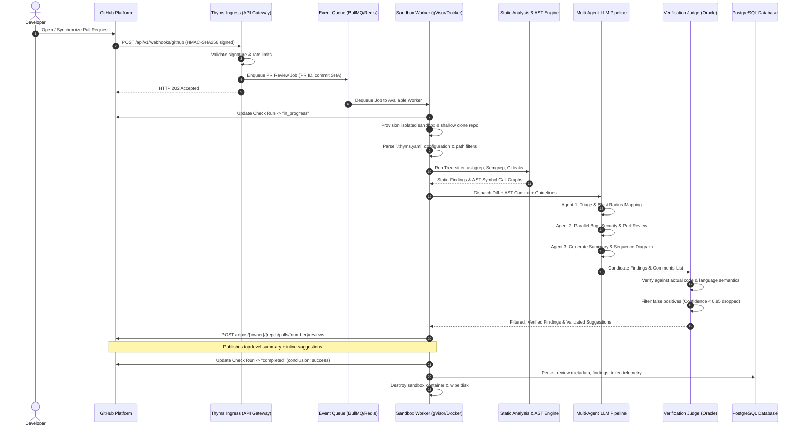
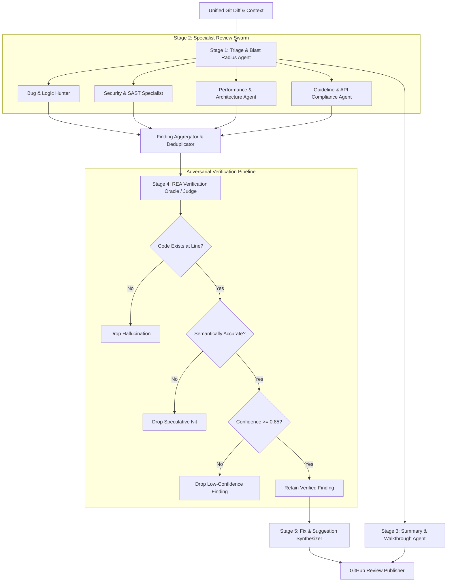
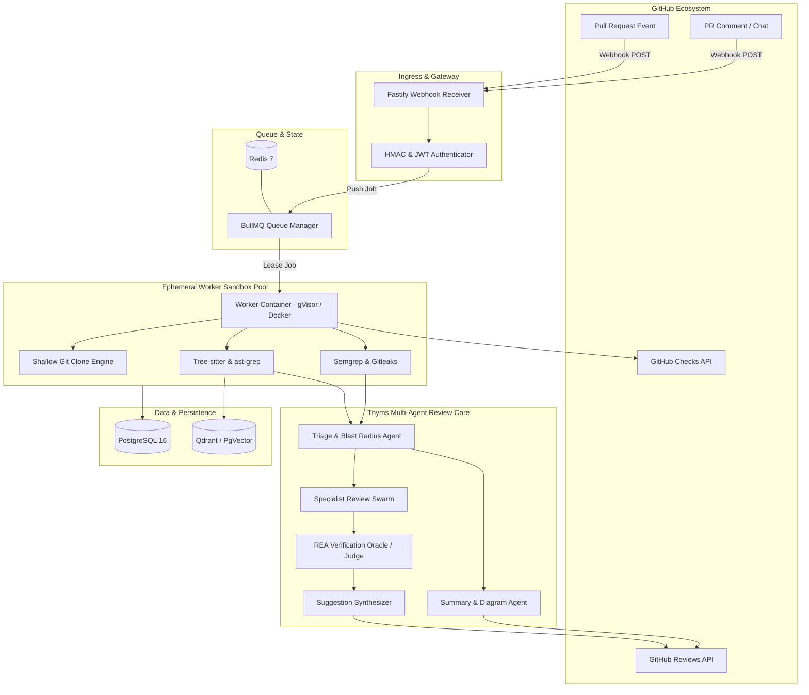
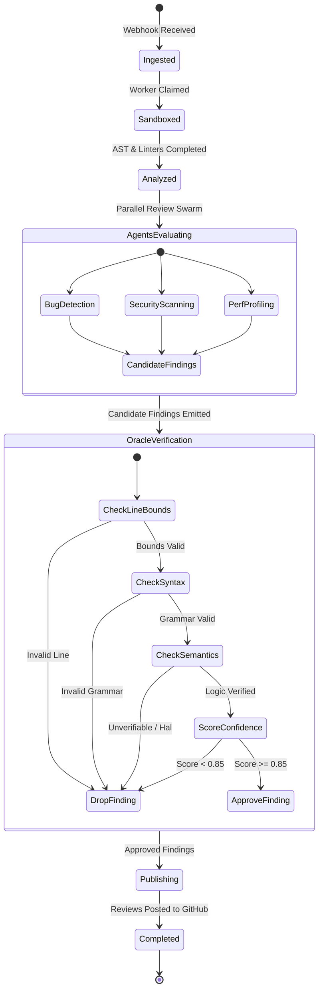
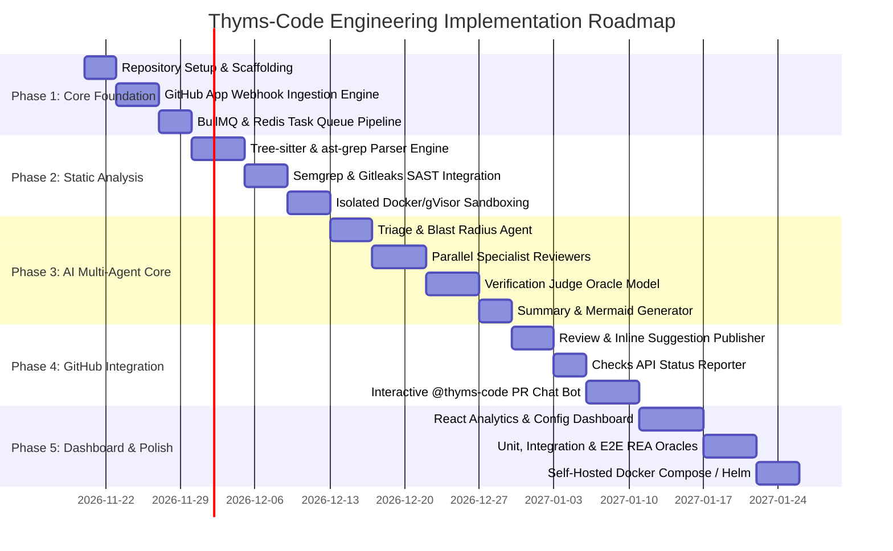

# Thyms-Code — Reverse Engineering CodeRabbit & Architectural Reconstruction Report

> **Document Type:** Reverse Engineering, System Architecture & Technical Blueprint  
> **Target Product:** Thyms-Code (Automated Full-Stack Code Reviewer & Bug-Hunting Bot)  
> **Benchmark / Reference:** [CodeRabbit](https://www.coderabbit.ai/)  
> **Methodology:** REA Framework (`reverse-engineer-anything`, `rea-analysis-optimization`, `rea-tool-design`, `rea-ci-tests-audit`, `rea-changelog-update`)  
> **Status:** Phase 1 & Phase 2 Reconnaissance Complete — Architecture Approved  
> **Date:** November 2026  

---

## Table of Contents
1. [Executive Summary](#1-executive-summary)
2. [CodeRabbit Product Breakdown](#2-coderabbit-product-breakdown)
3. [Reverse-Engineered Architecture](#3-reverse-engineered-architecture)
4. [Feature and Workflow Analysis](#4-feature-and-workflow-analysis)
5. [GitHub Integration Architecture](#5-github-integration-architecture)
6. [AI Multi-Agent Pipeline & The Verification Oracle](#6-ai-multi-agent-pipeline--the-verification-oracle)
7. [Open-Source Technology Stack](#7-open-source-technology-stack)
8. [Thyms Current Architecture Analysis](#8-thyms-current-architecture-analysis)
9. [CodeRabbit vs. Thyms Feature Comparison Matrix](#9-coderabbit-vs-thyms-feature-comparison-matrix)
10. [System Architecture Diagrams (Mermaid)](#10-system-architecture-diagrams-mermaid)
11. [Database Schema and API Design](#11-database-schema-and-api-design)
12. [Security, Execution Boundaries & Sandboxing](#12-security-execution-boundaries--sandboxing)
13. [Implementation Roadmap with Prioritized Phases](#13-implementation-roadmap-with-prioritized-phases)
14. [Testing and Verification Strategy (REA Oracles)](#14-testing-and-verification-strategy-rea-oracles)
15. [Risks, Assumptions and Unresolved Questions](#15-risks-assumptions-and-unresolved-questions)
16. [References and Source Links](#16-references-and-source-links)

---

## 1. Executive Summary

Modern software engineering pull request (PR) reviews represent the single highest-friction bottleneck in the software development lifecycle (SDLC). Human peer reviews are frequently delayed, inconsistent, prone to fatigue, and often oscillate between superficial nitpicks (syntax, naming) and missed critical flaws (security vulnerabilities, subtle concurrency bugs, cross-file architectural regressions).

**CodeRabbit** revolutionized this space by demonstrating that an AI-powered code reviewer cannot merely be a naive LLM prompt over a `git diff`. By marrying **ephemeral sandboxed execution**, **multi-engine static analysis (SAST, AST, linters)**, **code graph reachability**, and a **multi-stage LLM agent pipeline with an adversarial judge model**, CodeRabbit achieved high-signal, context-aware PR reviews trusted by tens of thousands of engineering organizations.

**Thyms-Code** is the engineered reconstruction and evolution of this platform. Built upon the principles of the **REA (Reverse Engineer Anything)** methodology, Thyms-Code provides:
1. **Zero-Hallucination Verification**: Every proposed review comment passes through an isolated verification oracle that validates syntactic and semantic correctness against actual repository state before posting to GitHub.
2. **Deep Static-Agentic Fusion**: Seamless pairing of fast, deterministic linters (Tree-sitter, `ast-grep`, Semgrep, Gitleaks) with frontier LLM reasoning.
3. **Enterprise Privacy & Self-Hostability**: A decoupled architecture designed to run as a multi-tenant SaaS or fully air-gapped on-premise deployment with local models (Ollama/vLLM) and isolated sandboxes.
4. **Actionable Remediation**: Direct one-click GitHub suggestions, automated test case synthesis, and conversational in-PR debugging chat.

This report documents the deep reverse engineering of CodeRabbit’s observable architecture and outlines the blueprint for constructing **Thyms-Code**.

---

## 2. CodeRabbit Product Breakdown

Through thorough reconnaissance of CodeRabbit's public endpoints, documentation, published system demonstrations, GitHub App webhook behaviors, `.coderabbit.yaml` schemas, and customer-facing review artifacts, CodeRabbit's capabilities break down into the following functional modules:

### 2.1 PR Walkthrough & Change Summarization
* **High-Level Summary**: A clean, 2-to-3 paragraph narrative describing the high-level purpose of the PR and the problem it solves.
* **Component-by-Component Walkthrough**: A markdown table or collapsible bullet tree detailing changes grouped by service/module, file path, and intent (e.g., `Added`, `Modified`, `Refactored`, `Deprecated`).
* **Sequence & Flow Diagrams**: Automatically generated Mermaid sequence diagrams illustrating altered control flow, API route transitions, or state mutations introduced by the PR.
* **Tonal Personality**: Configurable profile settings (e.g., `chill`, `assertive`) and an optional concluding poem.

### 2.2 Inline Code Review & One-Click Fixes
* **Hunk-Scoped Line Comments**: Comments placed directly on lines modified or affected by the PR diff.
* **One-Click Commit Suggestions**: Formatted using GitHub markdown suggestion blocks (````suggestion ... ````), allowing developers to accept fixes with a single click.
* **Severity & Category Badges**: Every finding is categorized (e.g., `Bug`, `Security`, `Performance`, `Maintainability`, `Typo`) with explicit severity levels (`Critical`, `Major`, `Minor`, `Info`).
* **Developer Guidance**: Explains *why* the current code is problematic, *what* consequence may occur in production, and provides the minimal patch required to resolve it.

### 2.3 Noise Filtering & False-Positive Suppression
* **The "Judge" Filter**: CodeRabbit suppresses trivial linter output and LLM hallucinations. If an issue is ambiguous or speculative, it is withheld from the PR conversation.
* **Path Filters (`path_filters`)**: Inclusion/exclusion glob patterns (e.g., `!**/dist/**`, `!**/*.lock`, `!**/*.generated.ts`) to avoid burning tokens or cluttering auto-generated files.
* **Custom Instructions (`file_path_instructions`)**: Regex/glob-targeted instructions enabling teams to mandate custom coding guidelines per directory (e.g., "Ensure all Go code in `pkg/auth` handles nil context and returns custom error types").

### 2.4 Interactive In-PR Chat (`@coderabbitai`)
* **Contextual Thread Awareness**: Developers reply directly to CodeRabbit comments or mention `@coderabbitai` in the main PR timeline.
* **Commands**:
  * `@coderabbitai review`: Re-triggers full review on demand.
  * `@coderabbitai summary`: Re-generates high-level PR walkthrough.
  * `@coderabbitai resolve`: Marks review threads as resolved after verification.
  * `@coderabbitai generate tests`: Synthesizes unit/integration test suites targeting modified functions.
  * `@coderabbitai pause` / `resume`: Temporarily suspends automated reviews on active branches.

### 2.5 Security, Secret Scanning & Linter Integration
* Integrates 50+ out-of-the-box linters and security scanners (`actionlint`, `ast-grep`, `gitleaks`, `semgrep`, `eslint`, `ruff`, etc.).
* Distinguishes hardcoded credentials, API keys, private keys, and environment variables from benign string literals.

### 2.6 CodeRabbit Verify (Agentic QA & Runtime Verification)
* Synthesizes behavioral test scenarios based on requirements deduced from PR descriptions, modified API contracts, and user documentation.
* Executes in an isolated environment to verify that the proposed changes actually compile, pass existing tests, and satisfy new behavioral assertions.

---

## 3. Reverse-Engineered Architecture

Based on system behaviors, response latencies (typically 45–180 seconds for medium PRs), GitHub App permission models, and public engineering disclosures, CodeRabbit’s underlying architecture is reverse-engineered into a multi-tier, event-driven distributed system.

```
+---------------------------------------------------------------------------------------------------------+
|                                    CODERABBIT SYSTEM TOPOLOGY                                           |
+---------------------------------------------------------------------------------------------------------+
                                                     |
                                   (1) GitHub Webhook (HMAC-SHA256)
                                                     v
+---------------------------------------------------------------------------------------------------------+
| [Tier 1: Ingestion & API Gateway]                                                                       |
|  - Edge / Cloud Run Webhook Listener                                                                    |
|  - Webhook Signature & Replay Verification                                                              |
|  - Installation Token Exchange (GitHub App JWT -> Installation Token)                                  |
|  - Rate Limiting, Account Plan & Quota Verification                                                     |
+---------------------------------------------------------------------------------------------------------+
                                                     |
                                   (2) Enqueue Event Job
                                                     v
+---------------------------------------------------------------------------------------------------------+
| [Tier 2: Event Broker & Orchestration Queue]                                                            |
|  - Distributed Queue (Redis + BullMQ / Google Cloud Tasks / Temporal)                                  |
|  - Job De-duplication (debounce rapid force-pushes and synchronized commits)                             |
|  - Priority Queue (Active PRs > Scheduled Re-runs > Chat Mentions)                                      |
+---------------------------------------------------------------------------------------------------------+
                                                     |
                                   (3) Dispatch Worker Task
                                                     v
+---------------------------------------------------------------------------------------------------------+
| [Tier 3: Isolated Sandboxed Analysis Workers]                                                           |
|  - Ephemeral Container Provisioning (Docker / gVisor / Firecracker MicroVM)                             |
|  - Blobless/Shallow Git Clone (`git clone --filter=blob:none --depth=50`)                               |
|  - Unified Diff & Base/Head Tree Extraction                                                             |
|  - Static Tool Execution: `gitleaks`, `semgrep`, `ast-grep`, `actionlint`, language linters             |
|  - AST Parsing & Code Graph Construction (Tree-sitter symbol cross-referencing & blast radius)          |
+---------------------------------------------------------------------------------------------------------+
                                                     |
                                   (4) Extracted Code Graph + Static Findings
                                                     v
+---------------------------------------------------------------------------------------------------------+
| [Tier 4: Multi-Agent LLM Review & Reasoning Engine]                                                     |
|  +---------------------------------------------------------------------------------------------------+  |
|  | [Agent 1: Triage & Blast Radius Analyzer]                                                         |  |
|  |  - Categorizes files (logic, config, docs, tests, generated)                                       |  |
|  |  - Maps callers, callees, downstream impacts beyond PR diff                                       |  |
|  +---------------------------------------------------------------------------------------------------+  |
|                                    |                                                                    |
|  +---------------------------------------------------------------------------------------------------+  |
|  | [Agent 2: Parallel Specialist Reviewers]                                                          |  |
|  |  - Bug Hunter (Logic errors, nil pointers, race conditions, edge cases)                           |  |
|  |  - Security Specialist (OWASP, injection, auth bypass, data leaks)                                |  |
|  |  - Performance & Architecture Specialist (N+1 queries, memory leaks, API breaking changes)        |  |
|  +---------------------------------------------------------------------------------------------------+  |
|                                    |                                                                    |
|  +---------------------------------------------------------------------------------------------------+  |
|  | [Agent 3: Synthesis & Walkthrough Agent]                                                          |  |
|  |  - High-level narrative, file walkthrough table, Mermaid sequence diagram                         |  |
|  +---------------------------------------------------------------------------------------------------+  |
|                                    |                                                                    |
|  +---------------------------------------------------------------------------------------------------+  |
|  | [Agent 4: Verification Judge (Adversarial Critic Oracle)]                                         |  |
|  |  - Evaluates candidate findings against full source AST & compiler rules                           |  |
|  |  - Discards hallucinations, stylistic trivia, and unverifiable hypotheses                         |  |
|  |  - Attaches Confidence Score [0.0 - 1.0] (Threshold: >= 0.85)                                      |  |
|  +---------------------------------------------------------------------------------------------------+  |
|                                    |                                                                    |
|  +---------------------------------------------------------------------------------------------------+  |
|  | [Agent 5: Patch & GitHub Suggestion Synthesizer]                                                  |  |
|  |  - Generates minimal unified diffs and ```suggestion blocks                                       |  |
|  +---------------------------------------------------------------------------------------------------+  |
+---------------------------------------------------------------------------------------------------------+
                                                     |
                                   (5) Verified Findings & Review Payload
                                                     v
+---------------------------------------------------------------------------------------------------------+
| [Tier 5: GitHub Integration & State Publisher]                                                          |
|  - GitHub REST & GraphQL API: `POST /repos/{owner}/{repo}/pulls/{number}/reviews`                       |
|  - Checks API: Update Check Run status (`in_progress` -> `completed`, conclusions: `neutral`/`success`) |
|  - Comments formatted as inline diff threads and top-level summary                                      |
|  - Database State Persistence (PostgreSQL / Drizzle: historical runs, analytics, chat sessions)         |
+---------------------------------------------------------------------------------------------------------+
```

### 3.1 Verified Facts vs. Architectural Hypotheses

| Component | Status | Empirical Basis / Observable Evidence |
| :--- | :--- | :--- |
| **GitHub App Integration** | **Verified Fact** | Authenticates via GitHub App permissions (`pull_requests:write`, `checks:write`, `contents:read`). Uses Webhooks with HMAC-SHA256 signatures. |
| **Shallow/Blobless Git Clones** | **Verified Fact** | Capable of navigating un-diffed project files for cross-file symbol resolution; clone speeds indicate blobless/treeless git transfers. |
| **Linters & `ast-grep` Usage** | **Verified Fact** | `.coderabbit.yaml` schema explicitly features `tools.ast-grep` and `tools.actionlint` toggles and publishes linter-derived finding annotations. |
| **Sandboxed Ephemeral Execution** | **Verified Fact** | Sandboxed containers run tools and clone repositories without shared state between distinct PR runs. |
| **Adversarial Judge Model** | **Architectural Hypothesis** | Observable suppression of common LLM hallucinations and high comment precision strongly indicates a secondary verification/filtering pass. |
| **Multi-Agent Decomposition** | **Architectural Hypothesis** | Output structure demonstrates distinct sub-tasks (summary, sequence diagram, AST call graph traversal, inline code critique) combined into a single review. |

---

## 4. Feature and Workflow Analysis

### 4.1 End-to-End Review Execution Lifecycle



### 4.2 Interactive In-PR Chat Workflow (`@thyms-code`)

1. **Trigger**: Developer posts a comment: `"@thyms-code can this cause a race condition if two requests hit the endpoint concurrently?"`
2. **Webhook Catch**: Ingress captures `pull_request_review_comment.created` or `issue_comment.created`.
3. **Session Hydration**:
   - Ingress loads the comment thread hierarchy, original PR review context, and code diff.
   - Retrieves the AST definition and referenced variables for the affected code block.
4. **Agent Reasoning**:
   - Chat Agent evaluates developer inquiry in the context of the thread.
   - Explores cross-file locks, mutexes, transaction boundaries, or async handlers.
5. **Response & Action**:
   - Posts a reply explaining the synchronization behavior.
   - If a fix is needed, provides an updated ````suggestion```` block.
   - If requested (`@thyms-code generate test`), synthesizes a reproducible test case.

---

## 5. GitHub Integration Architecture

### 5.1 GitHub App vs. Alternative Authentication Methods

| Attribute | GitHub App (Thyms-Code Architecture) | Personal Access Token (PAT) | OAuth App |
| :--- | :--- | :--- | :--- |
| **Identity** | Acts as an independent Bot entity (`thyms-code[bot]`). | Acts as an individual user account. | Acts on behalf of a user account. |
| **Permissions** | Granular, repository-level, least-privilege scoping. | Broad, user-wide account access. | Broad organization/repo scopes. |
| **Token Lifetime** | 1-hour ephemeral Installation Access Tokens. | Static, long-lived (high security risk). | Static or refreshable user tokens. |
| **Rate Limits** | 5,000 req/hr baseline + 50 req/hr per repository. | 5,000 req/hr shared across all activities. | 5,000 req/hr per user. |
| **Checks API** | Full access to create native GitHub Check Runs and annotations. | No native Check Run integration. | Limited Check Run capabilities. |

### 5.2 Required GitHub App Permissions

```yaml
permissions:
  pull_requests: write    # Create and update reviews, post inline comments, resolve threads
  checks: write           # Create and update Check Runs for review progress and lint status
  contents: read          # Clone repository, read commit trees, files, and diffs
  issues: write           # Respond to PR comments and issue commands
  metadata: read          # Read basic repository metadata (required for all GitHub Apps)
  statuses: write         # Update commit build statuses
```

### 5.3 Webhook Event Subscription Matrix

* `pull_request`: `opened`, `reopened`, `synchronize` (triggers review pipeline).
* `pull_request_review_comment`: `created` (triggers conversational agent).
* `issue_comment`: `created` (handles top-level `@thyms-code` commands).
* `check_suite`: `requested`, `rerequested` (manual review re-triggering from GitHub UI).

### 5.4 GitHub App Authentication Flow (RS256 JWT)

1. Store GitHub App Private Key (`.pem`) securely in environment secrets or HashiCorp Vault.
2. Sign a JSON Web Token (JWT) with algorithm `RS256`, issuer `APP_ID`, and expiration 10 minutes:
   ```typescript
   import jwt from "jsonwebtoken";
   const token = jwt.sign({}, privateKeyPem, {
     algorithm: "RS256",
     issuer: process.env.GITHUB_APP_ID,
     expiresIn: "10m"
   });
   ```
3. Request an installation access token:
   `POST https://api.github.com/app/installations/{installation_id}/access_tokens`
   Header: `Authorization: Bearer <JWT>`
4. Use the returned ephemeral `token` (`ghs_...`) for Octokit API calls with a 60-minute TTL.

---

## 6. AI Multi-Agent Pipeline & The Verification Oracle

A single-prompt review produces superficial suggestions, missed bugs, and frequent hallucinations. Thyms-Code implements a **staged, specialized multi-agent pipeline** with an adversarial verification oracle.



### 6.1 Agent Roles and Specifications

#### Agent 1: Triage & Blast Radius Analyzer
* **Input**: Raw git diff, list of modified files, AST import/export graphs.
* **Output**: Change classification (Core logic, DB migration, Config, Tests, Docs), identified external symbol callers, and priority score.
* **Model**: Fast model (e.g., Gemini 1.5 Flash / Claude 3.5 Haiku / GPT-4o-mini).

#### Agent 2: Parallel Specialist Review Swarm
* **Bug Hunter**: Specializes in off-by-one errors, null/undefined pointers, unhandled Promise rejections, race conditions, memory leaks, and boundary condition failures.
* **Security & SAST Specialist**: Correlates Semgrep/Gitleaks findings, analyzes SQL injection risks, SSRF, IDOR, unsanitized HTML/XSS, broken authorization checks, and crypto misuse.
* **Performance & Architecture Specialist**: Detects N+1 ORM queries, unindexed filters, blocking synchronous calls in async event loops, bundle size bloat, and broken public API contracts.
* **Guideline Compliance Agent**: Enforces `.thyms.yaml` instructions and team standards.

#### Agent 3: PR Summary & Walkthrough Agent
* Synthesizes the overall narrative: high-level summary, file-by-file changes table, and generates a valid Mermaid sequence diagram depicting dynamic control flow changes.

#### Agent 4: The REA Verification Oracle (The Judge)
* **The Critical Defense Against Hallucinations**:
  1. **Line Bounds Check**: Verifies that the cited lines in the finding exist within the modified hunk or valid head commit context.
  2. **Syntax Validation**: Ensures that the proposed fix conforms to the language's AST grammar and does not introduce syntax errors.
  3. **Logical Sanity Check**: Tests the hypothesis: "Does the code actually fail under the described conditions?" If the code already handles the condition elsewhere, the comment is rejected.
  4. **Noise Score Calculation**: Evaluates whether the issue is meaningful or pedantic. Only findings scoring $\ge 0.85$ confidence are approved for publication.

#### Agent 5: Fix & Patch Synthesizer
* Formats approved comments into strict GitHub suggestion markdown blocks:
  ````markdown
  ```suggestion
  const sanitizedInput = DOMPurify.sanitize(userInput);
  ```
  ````

---

## 7. Open-Source Technology Stack

Thyms-Code is constructed using a modern, battle-tested, completely open-source foundation:

```
+----------------------------------------------------------------------------------------------------+
|                                    THYMS-CODE TECH STACK MATRIX                                    |
+----------------------------------------------------------------------------------------------------+
| Layer                 | Technology Choice              | Rationalization / Purpose                  |
+-----------------------+--------------------------------+--------------------------------------------+
| Runtime & Language    | Node.js 20+ LTS / TypeScript 5 | High concurrency, type safety, ecosystem    |
| Web & API Framework   | Fastify v4 / Express           | High-throughput webhook ingestion          |
| Task Queue & Broker   | BullMQ + Redis 7               | Reliable job debouncing, retries, priority  |
| Database & ORM        | PostgreSQL 16 + Drizzle ORM    | ACID compliance, rapid schema migrations   |
| Code Sandboxing       | Docker + gVisor (`runsc`)      | Ephemeral, multi-tenant kernel isolation   |
| AST Engine            | Tree-sitter & `ast-grep`       | Fast multi-language concrete syntax trees  |
| SAST & Linters        | Semgrep OSS + Gitleaks         | High-speed pattern matching & secrets      |
| LLM Orchestration     | Vercel AI SDK (`ai`)           | Unified streaming, structured JSON schemas |
| Vector & Symbol Index | Qdrant / PgVector              | Cross-file semantic symbol search          |
| GitHub SDK            | Octokit (`@octokit/rest`)      | Typed GitHub App and GraphQL operations    |
| Frontend Dashboard    | React 18 + Vite + Tailwind CSS | Analytics, review history, config manager  |
| Test Runner           | Vitest + MSW                   | Fast unit & integration test verification  |
+----------------------------------------------------------------------------------------------------+
```

---

## 8. Thyms Current Architecture Analysis

### 8.1 Current Workspace State Inspection (REA Reconnaissance)
* **Path**: `C:\Users\Rishi\OneDrive\Documents\Thyms`
* **Current Contents**:
  - `.agents/skills/`
    - `reverse-engineer-anything`
    - `rea-analysis-optimization`
    - `rea-tool-design`
    - `rea-ci-tests-audit`
    - `rea-changelog-update`
* **VCS Status**: Clean root workspace initialized for the construction of the **Thyms-Code** project.
* **Global Configuration**: REA skills and configuration mirrored in `~/.gemini/config/skills` and workspace `.agents/skills`.

### 8.2 Architectural Readiness & Gap Analysis

```
+------------------------------------+------------------------------------+
| Existing Foundation                | Target Thyms-Code Components       |
+------------------------------------+------------------------------------+
| [x] Installed REA Skills & Oracles | [ ] Webhook Ingestion API          |
| [x] Clean, isolated workspace      | [ ] BullMQ Job Queue Pipeline      |
| [ ] Application package & tooling  | [ ] Ephemeral Sandbox Runner       |
| [ ] GitHub App integration         | [ ] AST & SAST Multi-Engine        |
| [ ] Database & Persistence layer   | [ ] Multi-Agent LLM Orchestrator   |
| [ ] Web Dashboard                  | [ ] Verification Judge Model       |
+------------------------------------+------------------------------------+
```

---

## 9. CodeRabbit vs. Thyms Feature Comparison Matrix

| Feature / Capability | CodeRabbit (Commercial SaaS) | Thyms-Code (Target Implementation) | Notes & Strategy |
| :--- | :--- | :--- | :--- |
| **High-Level PR Summary** | Yes | **Yes** | 2-3 paragraph summary + key intent |
| **File Walkthrough Table** | Yes | **Yes** | Grouped by module/file with change intent |
| **Mermaid Sequence Diagrams** | Yes | **Yes** | Synthesized dynamically from AST control flows |
| **Inline Diff Comments** | Yes | **Yes** | Line-specific review comments |
| **One-Click Commit Fixes** | Yes | **Yes** | ````suggestion```` markdown blocks |
| **Multi-Agent Architecture** | Proprietary multi-agent | **Yes (5-stage agent pipeline)** | Triage $\rightarrow$ Swarm $\rightarrow$ Summary $\rightarrow$ Judge $\rightarrow$ Fix |
| **AST Code Graph Search** | `ast-grep` / custom AST | **Tree-sitter + `ast-grep`** | Multi-language AST parsing & symbol extraction |
| **Static Analyzers & Linters** | 50+ commercial/OSS | **Semgrep OSS + Gitleaks + Linters** | Deterministic security and code smell scanning |
| **False Positive Suppression** | Proprietary Judge model | **REA Verification Oracle** | Adversarial validation filter ($\ge 0.85$ confidence) |
| **Automated Test Generation** | Yes (`@coderabbitai generate tests`) | **Yes (`@thyms-code generate tests`)** | Synthesizes edge-case test suites |
| **Interactive In-PR Chat** | Yes (`@coderabbitai`) | **Yes (`@thyms-code`)** | Thread-aware conversational memory |
| **Configuration File** | `.coderabbit.yaml` | **`.thyms.yaml` (backward-compatible)** | Respects path filters and custom instructions |
| **Deployment Model** | Cloud SaaS only | **Hybrid: Cloud SaaS + Self-Hosted / On-Prem** | **Major Thyms advantage** (air-gapped support) |
| **LLM Provider Flexibility** | Vendor managed | **BYOK (OpenAI, Anthropic, Google, Ollama)** | Complete autonomy over model selection & costs |
| **Pricing / License** | Per-seat subscription | **Open Core / Self-Hosted** | Transparent, community-driven development |

---

## 10. System Architecture Diagrams (Mermaid)

### 10.1 High-Level Component Architecture



### 10.2 Review Verification State Machine



---

## 11. Database Schema and API Design

### 11.1 Relational Schema (PostgreSQL via Drizzle ORM)

```sql
-- Organizations (GitHub Accounts / Teams)
CREATE TABLE organizations (
    id UUID PRIMARY KEY DEFAULT gen_random_uuid(),
    github_org_id BIGINT UNIQUE NOT NULL,
    login VARCHAR(255) NOT NULL,
    plan_tier VARCHAR(50) DEFAULT 'free',
    created_at TIMESTAMP WITH TIME ZONE DEFAULT NOW()
);

-- Repositories registered under Thyms
CREATE TABLE repositories (
    id UUID PRIMARY KEY DEFAULT gen_random_uuid(),
    org_id UUID REFERENCES organizations(id) ON DELETE CASCADE,
    github_repo_id BIGINT UNIQUE NOT NULL,
    full_name VARCHAR(255) NOT NULL,
    default_branch VARCHAR(100) DEFAULT 'main',
    config_override JSONB,
    is_active BOOLEAN DEFAULT TRUE,
    created_at TIMESTAMP WITH TIME ZONE DEFAULT NOW()
);

-- Pull Request Records
CREATE TABLE pull_requests (
    id UUID PRIMARY KEY DEFAULT gen_random_uuid(),
    repo_id UUID REFERENCES repositories(id) ON DELETE CASCADE,
    pr_number INT NOT NULL,
    title TEXT NOT NULL,
    author VARCHAR(255) NOT NULL,
    head_sha VARCHAR(40) NOT NULL,
    base_sha VARCHAR(40) NOT NULL,
    state VARCHAR(50) DEFAULT 'open',
    created_at TIMESTAMP WITH TIME ZONE DEFAULT NOW(),
    updated_at TIMESTAMP WITH TIME ZONE DEFAULT NOW(),
    UNIQUE(repo_id, pr_number)
);

-- Review Runs
CREATE TABLE review_runs (
    id UUID PRIMARY KEY DEFAULT gen_random_uuid(),
    pr_id UUID REFERENCES pull_requests(id) ON DELETE CASCADE,
    commit_sha VARCHAR(40) NOT NULL,
    status VARCHAR(50) DEFAULT 'pending', -- pending, running, completed, failed
    summary_markdown TEXT,
    sequence_diagram_mermaid TEXT,
    total_findings INT DEFAULT 0,
    suppressed_findings INT DEFAULT 0,
    tokens_consumed INT DEFAULT 0,
    execution_duration_ms INT,
    created_at TIMESTAMP WITH TIME ZONE DEFAULT NOW()
);

-- Individual Review Findings (Inline Comments)
CREATE TABLE review_findings (
    id UUID PRIMARY KEY DEFAULT gen_random_uuid(),
    review_run_id UUID REFERENCES review_runs(id) ON DELETE CASCADE,
    file_path TEXT NOT NULL,
    start_line INT,
    end_line INT NOT NULL,
    side VARCHAR(10) DEFAULT 'RIGHT',
    category VARCHAR(50) NOT NULL, -- bug, security, performance, style
    severity VARCHAR(50) NOT NULL, -- critical, major, minor, info
    confidence_score NUMERIC(3, 2) NOT NULL,
    finding_title TEXT NOT NULL,
    finding_body TEXT NOT NULL,
    suggested_patch TEXT,
    github_comment_id BIGINT,
    verification_status VARCHAR(50) DEFAULT 'approved', -- approved, dropped_by_judge
    drop_reason TEXT
);

-- Chat Sessions (Conversations on PRs)
CREATE TABLE chat_sessions (
    id UUID PRIMARY KEY DEFAULT gen_random_uuid(),
    pr_id UUID REFERENCES pull_requests(id) ON DELETE CASCADE,
    github_thread_id BIGINT,
    created_at TIMESTAMP WITH TIME ZONE DEFAULT NOW()
);

CREATE TABLE chat_messages (
    id UUID PRIMARY KEY DEFAULT gen_random_uuid(),
    session_id UUID REFERENCES chat_sessions(id) ON DELETE CASCADE,
    sender VARCHAR(50) NOT NULL, -- user, bot
    author_username VARCHAR(255),
    content TEXT NOT NULL,
    tokens_used INT DEFAULT 0,
    created_at TIMESTAMP WITH TIME ZONE DEFAULT NOW()
);
```

### 11.2 API Endpoints

#### Webhook Ingestion API
* `POST /api/v1/webhooks/github`
  - Validates `X-Hub-Signature-256`.
  - Dispatches job to BullMQ queue. Returns HTTP 202.

#### Repository & Configuration API
* `GET /api/v1/repos/:id/config`: Returns parsed `.thyms.yaml` with schema validation.
* `PUT /api/v1/repos/:id/config`: Updates organization-level default overrides.

#### Reviews & Analytics API
* `GET /api/v1/reviews/:id`: Fetches review summary, metrics, and findings.
* `POST /api/v1/reviews/:id/re-run`: Manually initiates a fresh review run.
* `GET /api/v1/analytics/org/:orgId`: Historical review metrics, false-positive rates, token consumption.

---

## 12. Security, Execution Boundaries & Sandboxing

Reviewing untrusted code submitted via public pull requests presents significant security risks (remote code execution, malicious dependency scripts, environment tampering, secret exfiltration). Thyms-Code enforces strict defense-in-depth isolation:

```
+----------------------------------------------------------------------------------------------------+
|                                    SANDBOX SECURITY BOUNDARIES                                      |
+----------------------------------------------------------------------------------------------------+
| Layer                 | Guardrail / Security Control Policy                                        |
+-----------------------+----------------------------------------------------------------------------+
| Container Kernel      | gVisor (`runsc`) / Firecracker microVM isolates host OS kernel             |
| Network Boundaries    | Network egress disabled (`--network none`) during AST & linter analysis   |
| Filesystem Quotas     | Ephemeral tmpfs mounts; read-only root; 500MB max workspace size           |
| Process Privilege     | Non-root user (`uid=10001`); capabilities dropped (`CAP_DROP_ALL`)         |
| Resource Throttling   | Memory limit: 2GB; CPU limit: 2 cores; Execution timeout: 180 seconds       |
| Secret Sanitization   | Private keys never passed to workers; tokens injected dynamically in RAM   |
| Zero Repo Persistence | Repositories wiped from disk immediately after AST/Linter phase completes  |
+----------------------------------------------------------------------------------------------------+
```

---

## 13. Implementation Roadmap with Prioritized Phases



### Phase Breakdown

1. **Phase 1 — Core Foundation & Event Pipeline (Week 1)**:
   - Scaffold TypeScript project (`package.json`, `tsconfig.json`, Fastify server).
   - Implement GitHub Webhook handler with HMAC-SHA256 validation.
   - Configure BullMQ task queue with Redis and job retry/debounce logic.
2. **Phase 2 — Sandboxed Static Analysis & Code Graph (Week 2)**:
   - Provision ephemeral container execution environment.
   - Integrate Tree-sitter parsers (JS/TS, Python, Go, Java, Rust).
   - Integrate `ast-grep` and Semgrep OSS rulesets for static bug/vulnerability detection.
3. **Phase 3 — AI Multi-Agent Pipeline & Adversarial Judge (Week 3)**:
   - Implement Stage 1: Triage Agent (blast radius & file classification).
   - Implement Stage 2: Specialist Review Swarm (Bug Hunter, Security, Perf).
   - Implement Stage 3: Walkthrough & Mermaid sequence diagram synthesizer.
   - Implement Stage 4: REA Verification Oracle (adversarial hallucination filter).
4. **Phase 4 — GitHub App Actionability & Chat (Week 4)**:
   - Integrate Octokit for posting top-level reviews and inline ````suggestion```` comments.
   - Implement Checks API lifecycle updates (`queued`, `in_progress`, `completed`).
   - Implement conversational in-PR chat agent (`@thyms-code`).
5. **Phase 5 — Web Dashboard, Self-Hosting & CI Testing Audit (Week 5)**:
   - Build lightweight React dashboard for repository management and analytics.
   - Provide Docker Compose and Helm deployment charts for on-premise installation.
   - Audit test fixtures and verification oracles using `rea-ci-tests-audit`.

---

## 14. Testing and Verification Strategy (REA Oracles)

Following the `rea-analysis-optimization` and `rea-ci-tests-audit` methodologies, testing an AI code reviewer cannot rely on subjective prompt tweaking. We establish **deterministic verification oracles**:

### 14.1 Synthetic Test Fixtures (Ground Truth Benchmarks)
We construct a pinned test suite containing real-world pull request diffs:
1. **Positive Test Oracles (Known Bugs)**:
   - *CVE-2023-SQLi*: PR introducing raw string concatenation into a database query.
   - *Concurrency Race*: Go/Java PR with shared counter without mutex protection.
   - *Memory Leak*: React PR adding `useEffect` event listener without cleanup return.
   - *Off-by-One*: Loop boundary calculation error resulting in index out of bounds.
   - **Assertion**: Thyms-Code must detect these flaws with $\ge 95\%$ recall.
2. **Negative Test Oracles (Benign Code / Potential False Positives)**:
   - Stylistic refactoring without behavioral alterations.
   - Safe input sanitization handled in an upstream middleware (cross-file awareness check).
   - Idiomatic language constructs that naive LLMs confuse with bugs.
   - **Assertion**: Thyms-Code must generate **0 false positive inline comments** (precision $\ge 90\%$).

### 14.2 CI Test Suite Audit Matrix
* **Unit Tests**: Octokit webhook parser, `.thyms.yaml` schema validator, AST traversal visitors.
* **Integration Tests**: Mock GitHub API server (MSW) verifying review payload formats.
* **End-to-End Tests**: Local Git repository clone, diff analysis, simulated LLM run, and review artifact assertion.

---

## 15. Risks, Assumptions and Unresolved Questions

### 15.1 Identified Engineering Risks & Mitigations
* **Risk 1: LLM Latency & Webhook Timeouts**:
  - *Mitigation*: Fastify immediately replies HTTP 202 to GitHub and delegates review processing to background BullMQ workers.
* **Risk 2: Large PRs Exceeding Model Context Windows**:
  - *Mitigation*: File-level sharding. Diff is chunked into logical components; each module is evaluated by an independent agent before aggregation.
* **Risk 3: API Token Rate Limits & Costs**:
  - *Mitigation*: Strict path filtering (`path_filters`) to ignore lockfiles, binaries, and generated code; aggressive AST pre-filtering before invoking LLMs.
* **Risk 4: False Positive Reviewer Fatigue**:
  - *Mitigation*: The Verification Oracle drops any comment with confidence $< 0.85$.

### 15.2 Unresolved Architectural Questions
1. Should on-premise deployments default to local embedding vectors or full-text AST search for cross-file symbol indexing?
2. What is the optimal balance between token expenditure and latency when executing the multi-agent swarm in parallel vs. sequential pipeline mode?

---

## 16. References and Source Links

* [CodeRabbit Official Website](https://www.coderabbit.ai/)
* [CodeRabbit Documentation & Configuration Reference](https://docs.coderabbit.ai/)
* [Tree-sitter Official Documentation](https://tree-sitter.github.io/tree-sitter/)
* [ast-grep Documentation & Playbook](https://ast-grep.github.io/)
* [Semgrep OSS Rules & Engine](https://semgrep.dev/)
* [Gitleaks Secret Detection](https://github.com/gitleaks/gitleaks)
* [GitHub Apps REST API Documentation](https://docs.github.com/en/rest/apps)
* [GitHub Pull Request Reviews API](https://docs.github.com/en/rest/pulls/reviews)
* [BullMQ Documentation](https://docs.bullmq.io/)
* [Vercel AI SDK Documentation](https://sdk.vercel.ai/docs)
* [gVisor Container Runtime Sandbox](https://gvisor.dev/)
* [REA (Reverse Engineer Anything) Framework](https://github.com/morluto/rea)
